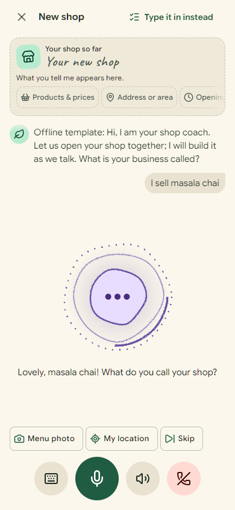
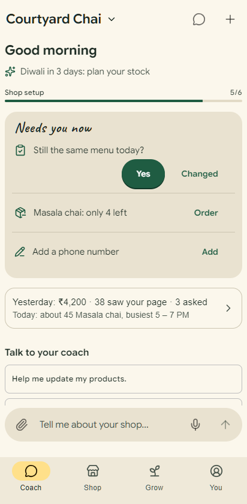
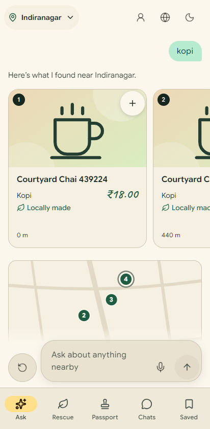
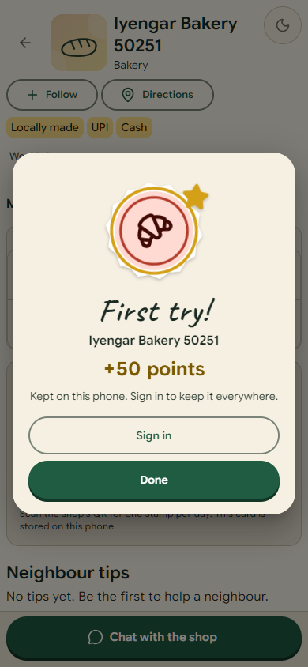
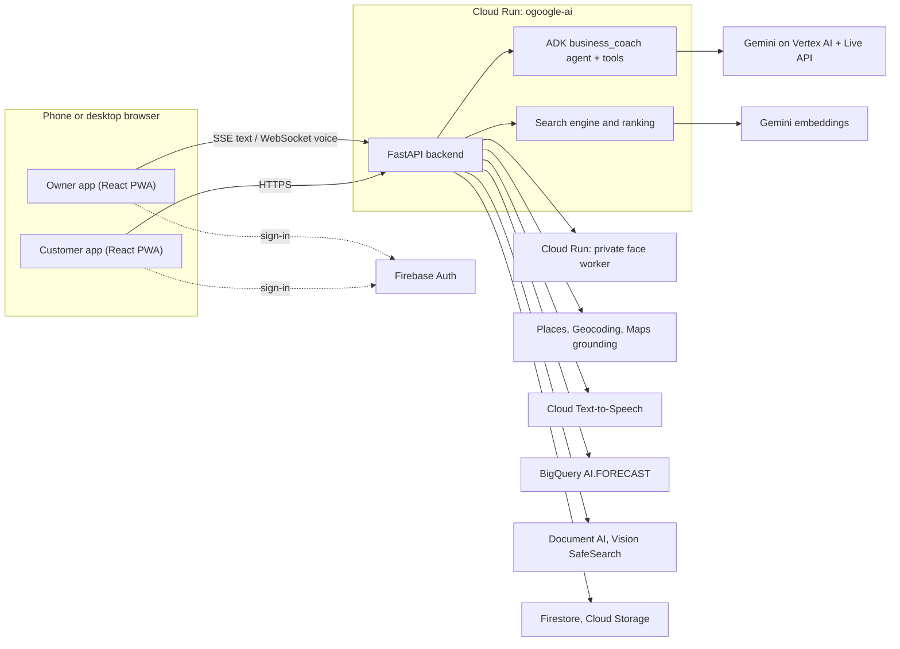

# Chalkboard

**Small neighbourhood shops get online by talking to an AI coach; their neighbours find them by asking.**

- Customers: <https://chalkboard.shreyaan.work>
- Shop owners: <https://business.chalkboard.shreyaan.work>
- Try the owner app without signing in: <https://business.chalkboard.shreyaan.work/demo>

Built for the Google AI Builder Cup (Retail & Commerce track).

| Talk to the coach                                                                                                                  | See what needs attention today                                                                                               | Ask for something nearby                                                                                                       | Collect a visit stamp                                                                                                    |
| ---------------------------------------------------------------------------------------------------------------------------------- | ---------------------------------------------------------------------------------------------------------------------------- | ------------------------------------------------------------------------------------------------------------------------------ | ------------------------------------------------------------------------------------------------------------------------ |
|  |  |  |  |

Screenshots come from the browser tests, with fictional shops.

## The problem and who it is for

Tea stalls, bakeries, kirana stores and hawker stalls in India and Singapore rarely have a
website, an up-to-date menu online or any stock planning. Their owners are busy, often on a
phone, and not always comfortable typing in English. Their neighbours, meanwhile, cannot find
out who nearby sells what, at what price, or whether it is open.

Chalkboard gives the owner a coach they can talk to in their own language, and gives the
customer one place to ask for what they need nearby.

## What it does

### Owner: from a conversation to a live shop page

- Sign in with Google and talk (voice) or type to the coach. A menu photo works too.
- The coach drafts the shop: name, kind of business, items, prices, hours and location. The owner
  reviews every proposed change before it is saved.
- The shop gets a public page and a QR code to print or share.
- Later changes are spoken or typed ("chai is sold out", "change the price") and confirmed the
  same way.

### Owner: Today, forecast, stock and supply

- **Today**: yesterday's numbers, today's forecast and one coach line, from saved records only
  (`backend/app/shop_today.py`).
- **Prep forecast**: seven-day item forecasts from approved sales, with TimesFM in BigQuery or a
  weekday average (`backend/app/forecast.py`).
- **Close the day** from typed numbers, a till receipt or a sales/stock photo.
- **Stock and supply chain** (`backend/app/supply_chain.py`): forecast → purchase order →
  confirmation → dispatch → invoice, with a three-way invoice match. Each supplier keeps its own
  format, so it works for every shop size: a WhatsApp-style message from a small wholesaler, a
  CSV/Excel export, or SAP IDoc XML for a large distributor. Gemini reads incoming documents into
  one model and flags uncertain fields. Demo suppliers are simulated and labelled; no live SAP or
  EDI network is connected and no money moves.
- **Connect a POS or ERP export** (CSV, XLSX, JSON or XML; `backend/app/connector.py`).

### Customer

- **Ask nearby**: "coffee under $3", "open now", follow-ups like "cheaper?". Results mix
  Chalkboard shops and Google places, ranked by meaning, words, distance, opening hours and price
  (`backend/app/search_engine.py`).
- **Area questions** ("parking near the market?") answered with Gemini grounded in Google Maps,
  with Google's source attribution.
- **Shop page**: menu, prices, directions, follow, chat with the owner.
- **QR stamps and Passport**: scanning a shop's signed QR inside the shop's radius earns one stamp
  a day, points, levels, streaks and sets (`backend/app/passport.py`).
- **Today's 7**: a short daily set of neighbourhood finds (`backend/app/today.py`).

### Languages

15 interface languages (`src/i18n/locales.ts`): English, 简体中文, Bahasa Melayu, தமிழ், हिन्दी,
বাংলা, తెలుగు, मराठी, ಕನ್ನಡ, 日本語, 한국어, Bahasa Indonesia, ไทย, Tiếng Việt and Filipino.
India and Singapore get their own currency, payments (UPI, PayNow) and language order
(`src/region/`). Shop content is shown in the customer's language.

## Google AI and Google Cloud

What the production configuration (`deployment/runtime-config.py`) turns on:

| Service                                        | Where it is used                                                                                                       |
| ---------------------------------------------- | ---------------------------------------------------------------------------------------------------------------------- |
| Gemini on Vertex AI (`gemini-3.5-flash`)       | Coach chat, photo and document reading, customer questions, supply-document translation (`backend/app/agent.py`)       |
| `gemini-3.5-flash-lite`                        | Fallback when the main text model is busy (`backend/app/text_model.py`)                                                |
| Gemini Live API (`gemini-3.8-live`)            | Real-time voice with the coach over WebSocket `/api/v1/voice` (`backend/app/voice.py`)                                 |
| Agent Development Kit (ADK)                    | The `business_coach` agent and its tools, shared by text and Live voice (`backend/app/agent.py`)                       |
| Gemini embeddings (`gemini-embedding-2`)       | Search over shops and items, and conversation recall (`backend/app/search_engine.py`, `backend/app/memory_vectors.py`) |
| Gemini image model                             | "Make my icon" for a shop (`backend/app/icons.py`)                                                                     |
| Grounding with Google Maps                     | Customer area questions (`backend/app/maps_grounding.py`)                                                              |
| Places API (New), Geocoding, Maps JavaScript   | Nearby places and photos, addresses, the map (`backend/app/discover.py`, `src/features/discover/mapsSdk.ts`)           |
| Cloud Text-to-Speech (Chirp 3 HD)              | Spoken coach replies in the owner's language (`backend/app/tts.py`)                                                    |
| BigQuery `AI.FORECAST` (TimesFM)               | Item demand forecasts (`backend/app/forecast.py`)                                                                      |
| BigQuery + Cloud Scheduler                     | Nightly per-shop analytics export (`backend/app/analytics.py`)                                                         |
| Document AI (Expense and Invoice parsers)      | Till receipts and supplier invoices, with Gemini as fallback (`backend/app/document_ai.py`)                            |
| Cloud Vision SafeSearch                        | Screens owner photos before anything is stored (`backend/app/photos.py`)                                               |
| Firebase Authentication                        | Google sign-in for owners and customers                                                                                |
| Firestore                                      | Shops, conversations, passports and vector recall                                                                      |
| Cloud Storage                                  | Accepted owner photos (private bucket)                                                                                 |
| Cloud Run                                      | The app (React + FastAPI in one service) and the private face worker                                                   |
| Artifact Registry, Cloud Build, Secret Manager | Images, the face-worker build (`scripts/ship-face.ps1`) and tokens                                                     |
| Workload Identity Federation                   | GitHub Actions deploys without a service-account key (`.github/workflows/deploy.yml`)                                  |

Built with Google tools: **Antigravity** (also the advisory PR reviewer in
`.github/workflows/agy-review.yml`) and **Gemini CLI** (`GEMINI.md`).

## Architecture



The face worker checks that an owner is a live person following head-movement prompts and
returns only a numeric template; it stores nothing (`backend/face_worker.py`,
`deployment/FACE_WORKER.md`).

A live version of this diagram is at <https://chalkboard.shreyaan.work/architecture>.

## Run locally

Prerequisites: Node.js 24, Python 3.13 and [uv](https://docs.astral.sh/uv/). From the repository root:

```sh
npm ci
uv sync --project backend --locked
```

Then, in two terminals at the repository root:

```sh
npm run dev:backend   # API on http://127.0.0.1:3300, seeds the fictional tour shops
npm run dev           # app on http://127.0.0.1:3200
```

Open the [owner app](http://127.0.0.1:3200/), the [customer app](http://127.0.0.1:3200/explore/)
or the [API docs](http://127.0.0.1:3300/docs). The development launcher (`scripts/backend-dev.mjs`)
always runs offline: a scripted coach, local sign-in, SQLite storage and photo fixtures, so no
Google credentials are needed. If a port is taken, set `WEB_PORT` and `API_PORT` in both terminals.

To use real Gemini locally, copy `backend/.env.example` to `backend/.env`, fill it in and run
`uv run python run.py` in `backend/`. The settings it reads (names only):

- Models: `COACH_MODE`, `GEMINI_BACKEND`, `GOOGLE_CLOUD_PROJECT`, `GOOGLE_CLOUD_LOCATION`,
  `GOOGLE_TEXT_MODEL`, `GOOGLE_LIVE_MODEL`, `GOOGLE_LIVE_LOCATION`, `GOOGLE_API_KEY` (only with
  `GEMINI_BACKEND=api_key`)
- Sign-in and storage: `AUTH_MODE`, `FIREBASE_WEB_API_KEY`, `FIREBASE_WEB_APP_ID`,
  `FIREBASE_AUTH_DOMAIN`, `SESSION_BACKEND`, `MERCHANT_BACKEND`, `MEDIA_BUCKET`,
  `SESSION_SIGNING_SECRET`
- Maps: `MAPS_SERVER_KEY`, `MAPS_BROWSER_KEY`, `MAPS_GROUNDING`
- Optional services: `FORECAST_BACKEND`, `DOCUMENT_AI_ENABLED`, `MODERATION_MODE`,
  `ANALYTICS_BACKEND`, `FACE_WORKER_URL`, `FACE_WORKER_TOKEN`

All options and their defaults are in `backend/app/settings.py`.

## Tests and quality

```sh
npm run lint && npm run build        # ESLint (no warnings) and a type-checked build
npm run rules                        # product rules (scripts/rules/)
npm run test:hooks                   # React hook rules
npm run test:ui                      # Playwright, phone and desktop
npm run test:ux                      # phone UX rules
npm run test:heatmap                 # attention heatmap against tests/heatmap/baseline.json
cd backend && uv run ruff check . && uv run mypy && uv run pytest -q
```

CI ([`checks.yml`](.github/workflows/checks.yml)) runs on every pull request and on pushes to main:
product rules; backend lint, format, types, tests against the Firestore emulator and a dependency
audit; the API contract (`backend/openapi.json` and `src/api/generated.d.ts` must match the
code); frontend lint, build and formatting; Playwright on phone and desktop; the UX gate; and a
check that the Docker image starts and answers. [`review-impact.yml`](.github/workflows/review-impact.yml)
comments which areas a pull request can affect. Releases are manual
([`deploy.yml`](.github/workflows/deploy.yml)) and rerun the checks first.

## Privacy and safety

- Owners accept the current Terms and Privacy Notice before any business change or upload.
- "Delete everything" erases an owner's records, memory, conversations, photos and face data
  (`DELETE /api/v1/me/data`); customers can delete their passport and preferences.
- Photos are re-encoded without location data and screened before storage; rejected photos are
  never kept.
- The face check keeps no image or video, only an encrypted numeric template.
- The public demo runs on a private, expiring sandbox with offline copies of every paid service;
  anything that would leave the sandbox (a real message, push, payment or face check) is not sent
  (`backend/app/public_demo.py`).
- Demo shops, offers and simulated suppliers are labelled. No payments are processed.

More: [backend guide](backend/README.md) · [deployment](deployment/README.md) ·
[contributing](CONTRIBUTING.md)
