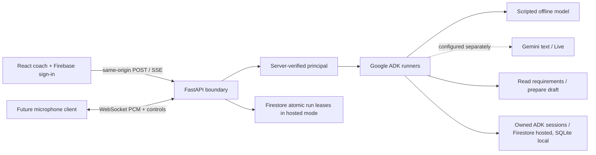

# Streaming AI foundation

This is one modular Python service, with a React client. Account and merchant workflows are deliberately separate from the model. No model tool can commit or publish.

## Responsibilities

| Layer                        | Owns                                                                                                      |
| ---------------------------- | --------------------------------------------------------------------------------------------------------- |
| React Context                | UI preferences and unverified browser business cards; no keys or authority                                |
| Stream hook                  | Request lifetime, progressive response, stop, error and retained input                                    |
| FastAPI                      | Validated input, principal-derived session ownership, exact-origin checks and limits                      |
| ADK                          | Conversation and narrow read/propose tools, through separate text and Live runners                        |
| Business application, future | Business-scoped roles, validated factual proposals, exact approval, idempotent commits and audit receipts |

The text producer runs in a separate bounded asyncio task. Browser disconnect cancels it once, then cleanup is shielded from repeated SSE cancellation. This prevents interrupted SQLite cleanup from poisoning a later turn. Response middleware is pure ASGI and does not buffer output.

## Text contract

1. Bootstrap the local cookie; Firebase mode instead requires a valid bearer token.
2. POST `{ "message": "My tea shop", "language": "en", "session_id": null }` to `/api/v1/coach/stream`.
3. Parse SSE `data` JSON: `ready` includes an opaque owned UUID and mode, `delta` appends text, `reply` replaces partial text with the complete reply, `turn_complete` confirms completion. `error` contains a public code.
4. Abort the fetch to stop. Keep the input until completion; do not auto-replay or commit. The UI rejects truncated streams.

No thoughts, raw tool arguments, provider exceptions or tokens are exposed. OpenAPI defines REST inputs and the reusable event schemas; WebSocket semantics below are separately documented. Live inference is not established by the offline model.

## Voice contract

`ws://127.0.0.1:3200/api/v1/voice` uses the same-origin development proxy. Production requires WSS and an allowed origin. Local mode uses the cookie. Firebase mode authenticates through the first bounded JSON frame `{ "kind": "authenticate", "token": "…" }`, within five seconds; never put tokens in URLs. Optional `session_id` is an owned UUID.

After `ready`, send binary little-endian signed 16-bit mono PCM at 16 kHz. Each frame is at most 32,768 bytes. Controls: `text` with `text`, `audio_end`, `close`, `ping`. The Live adapter forwards input to ADK `LiveRequestQueue` and concurrently consumes `Runner.run_live`. Output has JSON transcript/interruption/turn events and an `audio_format` event before binary 24 kHz PCM. On `interrupted`, a future playback client must clear queued audio. The server does not implement browser audio capture/playback.

Offline mode exercises transport without ASR. Its audio-end reply explicitly says no speech recognition occurred. Tests substitute the Live runner to validate PCM forwarding, output, interruption and task cleanup without contacting Google. This is adapter evidence, not live speech evidence. Live `ping` handling is not provided; use transport-level keepalive.

## Bounds and outstanding production work

Requests: 16 KiB body, five-second body deadline, 2,000-character message. Text: 30-second turn, four model calls, 384 output-token configuration, bounded eight-event queue, five-second cleanup deadline. Voice: 120-second session, four-million-byte input, 12 text turns. Workspace: 20 conversations and 60-event context threshold. One active run per conversation and eight global runs in hosted Firestore mode (process-local in SQLite review mode). These are resource limits, not an exact cost cap.

Hosted mode provides Google sign-in, Firestore session durability, user-scoped history/resume and transaction-backed distributed run leases. The deployment workflow packages React and Python into one HTTPS Cloud Run service; local mode retains SQLite. Both reject unauthorized session access. Shared Firestore has a dedicated app namespace, with project-scoped runtime datastore IAM. Business records/access policies, retention controls, provider evaluation, real Google publishing and native host placement remain outstanding. Deployment and real human OAuth results must be verified separately from emulator/token-mock tests.

Sources: [ADK streaming](https://adk.dev/live/get-started/streaming-python/), [custom Live server](https://adk.dev/live/custom-server/), [FastAPI WebSockets](https://fastapi.tiangolo.com/advanced/websockets/).
