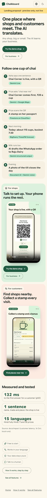

# Landing plan: obvious in 5 seconds

Proposal only. The approved landing (`Marketing.tsx`, `landing.css`, `v1/Landing.tsx`) is
unchanged. The proposal is live as a separate, noindex preview route so you can judge it on a
phone: **`/landing-preview`** (either host). The 390 px mock is below.

## The one story

**One place where shops and customers meet. The AI translates.**

Everything on the page follows **one cup of chai** at Chai Corner. Each step shows the
Google technology doing it, so a judge can see where the Google tech sits without reading a
paragraph:

| #   | Who / when                     | What happens                                   | Google technology           |
| --- | ------------------------------ | ---------------------------------------------- | --------------------------- |
| 1   | Asha (owner) says one sentence | Chai Corner is live, with a QR                 | Gemini Live                 |
| 2   | Priya asks "chai near me"      | Chai Corner comes first, ₹20 a cup             | Gemini + Google Maps        |
| 3   | Priya scans the QR             | A stamp on her passport                        | Firestore on Cloud Run      |
| 4   | Next morning                   | Today: about 115 cups, busiest 7:30            | BigQuery TimesFM forecast   |
| 5   | Milk runs low                  | The AI drafts the WhatsApp order to Raju Dairy | Gemini structured output    |
| 6   | Evening                        | A photo of the till closes the day             | Document AI + Gemini vision |

"The AI translates" is meant literally. The same order goes out in each partner's own format:
a WhatsApp message to a local dairy, an email with a CSV to a minimart's supplier, and an SAP
IDoc only between a supermarket chain and an FMCG company. The shop-owner video shows that
choice in one scene. No tea stall ever sends an IDoc.

## Page order (phone first, one screen per idea)

1. **One line + one action.** The headline above, "Any shop, big or small. The AI learns your
   business." underneath, then **Try the demo shop** (primary) and For business (secondary).
2. **Follow one cup of chai.** The six steps as cards, each with its Google chip.
3. **For shops | For customers.** Side by side on desktop, stacked on a phone. Each side has one
   line, its phone demo video (muted, autoplays in view, controls, poster, lazy) and one button.
4. **Measured and tested.** Three numbers, each with its source:
   - **132 ms** to the first answer for a customer (p50; 308 ms p95).
     Source: `docs/impact/customer-latency.md`, 16 Oct, 5 Playwright runs.
   - **1 sentence:** name, trade and place, and the shop is live.
     Source: `tests/acceptance/critical-flows.spec.ts`, which runs in English and Hindi.
   - **15 languages:** Hindi is fully Hindi, and prices show in ₹ and S$.
     Source: `src/i18n/locales.ts` and the locale completeness tests.
5. **Trust strip:** Free to start · Works in your language · Your data stays yours · Talk to a
   human.
6. **Links:** How it works, step by step (`/how-it-works`) and See all features (`/features`).

## The videos

Two videos, one per flow, each with Hindi and English captions. Both are recordings of the real
app on a 390 × 844 phone at device scale 3, framed in a phone shell with HyperFrames.

- **Shop owner, 39 s:**
  1. Talk to set up (the real voice screen fills in name, trade and place).
  2. Live, with a QR.
  3. Today shows what needs you first.
  4. The AI drafts the order: 12 l milk, ₹540, 7-day credit, sent as a chat message.
  5. The channel scene: tea stall → WhatsApp, minimart → email + CSV, supermarket chain → SAP
     IDoc.
  6. A till-screen photo becomes the menu.
- **Customer, 27 s:**
  1. Ask "chai" near Indiranagar.
  2. Open Chai Corner: the menu in ₹.
  3. Follow it.
  4. Scan the QR.
  5. A stamp and a scratch-card bonus.
  6. The passport.

Files are in `public/how-it-works/` (0.7–1.1 MB each, with a poster). To rebuild them, see
`scripts/howitworks-videos/` (`record-*.ts`, then `compose.mjs`).

## 390 px mock

## To approve

- [ ] The one line: "One place where shops and customers meet. The AI translates."
- [ ] The chai story as the page's spine, with a Google chip on every step.
- [ ] The three numbers, or swap in others from `docs/impact/`.
- [ ] Whether the live landing's hero links to `/how-it-works` and `/features`, or the landing is
      replaced by this layout.
