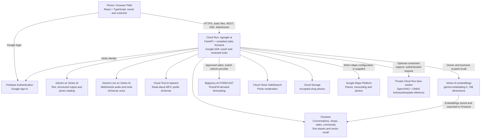
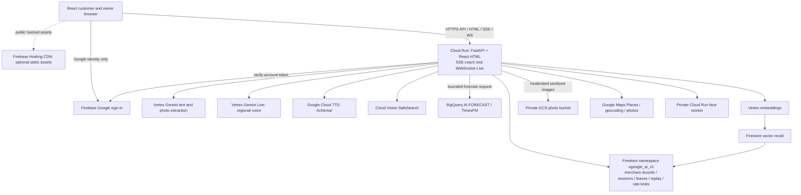

# Chalkboard architecture

Source review: 16 October 2026, checkout `fb483b2`. The diagram shows implemented paths;
configuration and live evidence are recorded separately in [Google AI used](google-ai.md).
No cloud service was contacted for this review.



## Request and data flow

The [Dockerfile](../Dockerfile) builds React and serves its output through
[frontend.py](../backend/app/frontend.py) in the same service as
[FastAPI](../backend/app/main.py). The two public domains share this application;
[router.ts](../src/app/router.ts) selects the owner or customer experience by host/path.
[PWA registration](../src/app/pwa.ts) and [service worker](../public/sw.js) exist;
installation and physical-phone offline behaviour still need device verification.

[ADK](../backend/app/agent.py) runs one `business_coach` agent with tools from
[coordinator.py](../backend/app/coordinator.py), rather than a deployed specialist-agent network.
[streaming.py](../backend/app/streaming.py) streams text over SSE;
[voice.py](../backend/app/voice.py) relays microphone audio, transcriptions, responses and tool
events through Gemini Live. [tts.py](../backend/app/tts.py) separately calls Cloud TTS for
read-aloud; the browser can fall back to its own speech voice. TTS is not a Gemini inference call.

Firebase establishes account identity. Server-side ownership checks scope conversations and
business records; owners review proposed changes before committing them. Firestore adapters
persist [sessions and leases](../backend/app/firestore_memory.py),
[merchant records](../backend/app/merchant_firestore.py) and
[customer/community data](../backend/app/community.py) under `ogoogle_ai_v1` in `ichiropractic`.

[memory_vectors.py](../backend/app/memory_vectors.py) calls Vertex embeddings, then Firestore
`find_nearest` for owner/business conversation recall. This is **Firestore vector search**;
there is no Vertex AI Vector Search endpoint or shared semantic product-search engine in this
checkout. Customer intent uses [Gemini plus catalogue matching](../backend/app/discover_ask.py);
[supplier search](../backend/app/sourcing.py) has its own implementation.

[forecast.py](../backend/app/forecast.py) sends approved sales as parameterized inline data to
BigQuery `AI.FORECAST` using dataset context `ichiropractic.chalkboard_analytics`. It requires
28 recent recorded days per item, returns seven days and falls back to a labelled weekday
average on provider failure. This adapter writes no merchant analytics tables. Sales summaries,
page counts and customer insights are calculated in the app from stored records. Release 2 adds
a nightly BigQuery analytics export and a Looker Studio dashboard on it; see
[Google services added in release 2](#google-services-added-in-release-2).

[photos.py](../backend/app/photos.py) sanitizes images, calls Vision SafeSearch and Gemini,
and stores accepted media in Cloud Storage. Menus, receipts and day-closing photos are read
by Gemini; see [day_close.py](../backend/app/day_close.py) and [ingestion.py](../backend/app/ingestion.py).
The optional [face worker](../backend/face_worker.py) returns a template after its liveness
checks; [trust.py](../backend/app/trust.py) encrypts it in the shared document store and flags
possible duplicate accounts for review. This uses non-Google inference models and does not
establish business ownership or calibrated fraud-detection accuracy.

## Configuration and boundaries

[settings.py](../backend/app/settings.py) defaults to offline coach, local identity, SQLite,
fixture photo moderation and weekday forecasting. The [local launcher](../scripts/backend-dev.mjs)
enables the product routes with offline fixtures. [runtime-config.py](../deployment/runtime-config.py)
selects Vertex Gemini, Firebase, Firestore, Vision and BigQuery for releases;
[deploy.yml](../.github/workflows/deploy.yml) supplies the private face worker and Maps settings.
These files describe intended release settings, not a fresh inspection of the running revision.

The diagram above was drawn from `fb483b2`, before release 2. Release 2 adds code for Document
AI receipts and invoices ([document_ai.py](../backend/app/document_ai.py), `DOCUMENT_AI_ENABLED`),
Gemini grounding with Google Maps ([maps_grounding.py](../backend/app/maps_grounding.py),
`MAPS_GROUNDING` off/demo/live) and Recommendations AI ([retail_recs.py](../backend/app/retail_recs.py),
`RECS_ENABLED`, off by default). The release settings in
[runtime-config.py](../deployment/runtime-config.py) turn on Document AI and BigQuery analytics.
Recommendations AI has its catalog imported, and the "Similar items" model is still pending
console creation ([status](impact/recommendations-ai.md)). Until it serves, similar items come from
embeddings. See the [pending-services note](google-ai.md#pending-services--not-counted-as-used).

Chalkboard pages and QR sharing do not publish to Google Business Profile. The Google guide
hands off to Google's own pages. Cloud Run storage durability comes from Firestore and Cloud
Storage, not local SQLite or the container filesystem.

<!-- Release 2 sections follow (Google services added in release 2, deployment evidence). -->

## Google services added in release 2

One line per Google service the app calls, its switch and what happens without it. Streaming and
the coach runtime are described in [AI_ARCHITECTURE.md](AI_ARCHITECTURE.md).

| Service                                                                                                                                               | Where                                                                                                                                                                                                     | Switch                                                              | Without it                                                                                                                                                          |
| ----------------------------------------------------------------------------------------------------------------------------------------------------- | --------------------------------------------------------------------------------------------------------------------------------------------------------------------------------------------------------- | ------------------------------------------------------------------- | ------------------------------------------------------------------------------------------------------------------------------------------------------------------- |
| **Document AI** (Expense parser for till receipts, Invoice parser for supplier invoices and delivery notes; `us`)                                     | Close the day `/day/read` (`backend/app/document_ai.py`)                                                                                                                                                  | `DOCUMENT_AI_ENABLED` + processor IDs                               | Gemini vision reads the photo (also used whenever the Document AI reading is incomplete). Accuracy: [impact/document-ai.md](impact/document-ai.md)                  |
| **BigQuery analytics** (`chalkboard_analytics`, asia-south1): `shop_daily` per shop × day, views `impact_daily`, `forecast_accuracy`, `latency_daily` | Nightly export `POST /api/v1/internal/analytics/export` (Cloud Scheduler `chalkboard-analytics-export`, OIDC); owner card "Your week" reads `GET /businesses/{id}/analytics` (`backend/app/analytics.py`) | `ANALYTICS_BACKEND=bigquery` + `ANALYTICS_EXPORT_CALLER`/`AUDIENCE` | The card is computed from the shop's saved records (no page views, which only the request logs have). Dashboard: [impact/looker-studio.md](impact/looker-studio.md) |
| **Looker Studio**                                                                                                                                     | Impact dashboard on the same dataset, for judges                                                                                                                                                          | Configured in the browser                                           | Nothing in the app depends on it                                                                                                                                    |
| **Cloud Logging → BigQuery sink** `chalkboard-requests` (existing)                                                                                    | Cloud Run `/api/` request logs into `chalkboard_analytics`                                                                                                                                                | —                                                                   | Page views and latency are missing from analytics                                                                                                                   |

Privacy: analytics rows carry a shop pseudonym (`shop_key`, a hash of the shop ID: not
anonymisation), its category, country and currency, and daily counts/sums. No names, owner IDs,
customer messages, contacts, IPs or user agents. Erasing an account deletes its shops' rows
(erasure step `analytics`). Exported days are loaded with WRITE_TRUNCATE per partition (free load
jobs; a re-run replaces the day).

## Deployment and scaling evidence

Source inspection: 16 October 2026. Solid edges below are implemented adapters in this
checkout, not proof of live calls. Dashed edges are proposed CDN delivery. Production was
not contacted; current configuration and quotas remain unverified.



Google identity, business authority, liveness and public publishing remain separate. The
Google guide hands off to Google's pages; it does not establish native Google placement.
The private face worker is a separate workload; its in-memory templates and one-instance
limit do not make it horizontally scalable or durable. GCS remains private: gallery APIs
check owner/sharing rights before bytes are served. New approved intake objects are
`private, no-store`; gallery objects use `private, max-age=3600` metadata. Existing public
gallery responses have a one-day public cache, so hiding/deleting cannot revoke cached bytes.

### Capacity and cost

There are three conflicting **source records**, none a current cloud measurement:

| Record                                      | Min / max | Concurrency | CPU / RAM            | Timeout / CPU billing |
| ------------------------------------------- | --------- | ----------- | -------------------- | --------------------- |
| `deployment/target.json`, historical memory | 0 / 1     | 8           | historical 1 / 1 GiB | 180s / request        |
| old CI deploy arguments at branch base      | 1 / 10    | 40          | 1 / 2 GiB            | 3600s / always-on     |
| `deployment/README.md` historical prose     | 0 / 10    | 16          | 1 / 1 GiB            | 180s / request        |

This change stops release CI from resetting capacity. Claude should inspect only selected
non-secret fields; never print a full service YAML or its environment:

```powershell
gcloud run services describe ogoogle-ai --project ichiropractic --region asia-south1 --format="json(spec.template.metadata.annotations,spec.template.spec.containerConcurrency,spec.template.spec.timeoutSeconds,spec.template.spec.containers[0].resources,status.latestReadyRevisionName,status.traffic,metadata.annotations)"
gcloud run services describe ogoogle-face --project ichiropractic --region asia-south1 --format="json(spec.template.metadata.annotations,spec.template.spec.containerConcurrency,spec.template.spec.timeoutSeconds,spec.template.spec.containers[0].resources,metadata.annotations)"
```

30,000 **daily** users at ten dynamic requests each is ~3.5 requests/s average, ~35/s at a
10x burst. At an assumed 300ms average service time that is ~11 simultaneous requests.
These are sizing assumptions, not measured cloud capacity. 30,000 simultaneous users or
many concurrent Live sessions is a different workload and cannot be promised under ₹500.

Proposed first bounded trial after quota/credit checks: max 3 instances, concurrency 16,
1 CPU, 2 GiB, 180s timeout, min 0 outside judging, request-based CPU. Short text turns keep
their 30s app deadline; Live remains bounded by its 150s session cap, so a 3600s request
timeout adds no useful capacity for this implementation. Avoid enabling session affinity as
a scaling strategy; persistent state lives in Firestore. Do not increase face-worker max.

**Not run; Claude executes only after reviewing existing values and budget headroom:**

```powershell
gcloud run services update ogoogle-ai --project ichiropractic --region asia-south1 --max=3 --max-instances=3 --concurrency=16 --cpu=1 --memory=2Gi --timeout=180 --cpu-throttling --no-session-affinity --quiet
```

Both service and revision maximums are set so an existing service-level cap of one cannot
silently prevent the trial from scaling. Keep both caps aligned and inspect effective traffic.
Record the inspected old values and reverse those exact settings if error rate, latency or
spend rises. Do not reset to an assumed historical configuration. Max instances limits
resources, not money; warm instances, provider calls, Firestore and bandwidth still cost.
Preserve the ₹500 total cash ceiling and paused budget setup; alerts cannot enforce it.

### Quotas, bottlenecks and graceful degradation

| Service / boundary         | Implemented behavior / limit                                                                           | Claude must verify before raising traffic                                                                          |
| -------------------------- | ------------------------------------------------------------------------------------------------------ | ------------------------------------------------------------------------------------------------------------------ |
| Vertex Gemini text         | Explicit model/location; text deadline 30s; errors become retryable stream states                      | Project/model/location capacity, shared vs provisioned throughput, 429 rates; no fixed universal RPM is asserted   |
| Gemini Live                | Regional model; at most 150s per session; shared run lease                                             | Concurrent session and throughput allowance for `gemini-3.8-live` in `us-central1`                                 |
| Global coach admission     | `MAX_ACTIVE_RUNS=8` across the **namespace**, not per instance; Firestore transaction on one lease doc | Contention and occupied slots; adding instances does not multiply eight into 24                                    |
| Firestore                  | Durable owned sessions/replay and distributed rate limits                                              | Reads/writes, index/storage usage and lease/rate-counter hotspots; customer discovery currently scans shared shops |
| Embeddings / vector recall | Explicit embedding model and owner/business scope                                                      | Model throughput, dimensions/index availability, read and embedding cost                                           |
| BigQuery TimesFM           | Forecast cache and weekday-average fallback; no table import in inline query                           | BigQuery job/AI.FORECAST quotas, query cost, concurrent jobs, region/model availability                            |
| TTS / Vision / Maps        | Bounded requests, provider errors and fixture fallbacks; Maps has 600s process cache and single-flight | Per-project API quotas, daily caps, billing and content/cache restrictions                                         |
| Cloud Run / GCS / CDN      | Instance/concurrency caps; private GCS; optional CDN for assets only                                   | Regional CPU allowance, GCS egress, Hosting storage/transfer allowance and first-release WIF permission            |

Claude can inspect quota dimensions without exposing credentials:

```powershell
gcloud beta quotas info list --service=aiplatform.googleapis.com --project=ichiropractic
gcloud beta quotas info list --service=texttospeech.googleapis.com --project=ichiropractic
gcloud beta quotas info list --service=vision.googleapis.com --project=ichiropractic
gcloud beta quotas info list --service=bigquery.googleapis.com --project=ichiropractic
```

Some shared-throughput and model-specific limits are not returned as editable project quota;
check the relevant Vertex model/location page and monitoring in Cloud Console. Do not request
quota increases, provisioned throughput, billing activation or new paid models as part of this
handoff. Current numeric allowances are **unknown**, not unlimited. Consult official Cloud Run,
Firebase Hosting, Vertex quotas and BigQuery AI.FORECAST documentation when Claude has permission
to access external services; this task prohibited that access.

On 429/timeout/provider failure the existing UI retains input and offers retry/typing instead;
the stream reports failure instead of a fabricated answer. There is **no durable user queue**:
the run cap returns busy/try-again, and the UI should not claim someone is queued. Existing
Maps/forecast caches reduce repeats; they are process-local, cold on new instances and cannot
guarantee a shared hit rate. Customer factual answers can use confirmed shop data; never cache
private cross-owner answers or silently call an offline fixture a live Gemini answer. A shared
answer cache and queue are future work, requiring privacy/expiry/backpressure design.

### Evidence boundary

The [local load report](impact/load-test.md) exercises public shop reads, discovery and the
offline SSE coach on one loopback process with ten shops. It measures neither Firestore nor
Google inference/ASR, CDN hit rate, autoscaling, cold starts or 30,000-user production readiness.
No live service in the diagram is claimed as independently verified by this change.
