# Chalkboard architecture

Checked against production on **18 October 2026**: Cloud Run services `ogoogle-ai` (revision
`ogoogle-ai-00079-pjc`, serving `36368f0b`) and `ogoogle-face`, the Cloud Armor policy, Cloud
Scheduler, BigQuery datasets and the runtime switches (names and non-secret values only). The
same diagram is in the app at **/architecture**
([ArchitecturePage.tsx](../src/architecture/ArchitecturePage.tsx)); both come from
[diagram.ts](../src/architecture/diagram.ts), and
[architecture.spec.ts](../tests/architecture.spec.ts) fails if they drift apart.

```mermaid
flowchart TD
  subgraph people["Phones"]
    pwa["Chalkboard PWA<br/>React + TypeScript, owner and customer apps, 15 languages"]
    auth["Firebase Auth<br/>Google sign-in, verified on the server"]
    ga4["Google Analytics 4<br/>Consent-gated flow events, no personal data"]
  end
  subgraph gateway["Edge"]
    armor["HTTPS load balancer + Cloud Armor<br/>300 requests a minute per IP, then 429"]
  end
  subgraph run["Cloud Run ogoogle-ai (asia-south1)"]
    api["FastAPI + React<br/>Stateless; 1 to 10 instances, 40 requests each; SSE text, WebSocket voice"]
    understand["Business understanding<br/>Gemini profile of any business: kind, offer, never-ask list, extra questions"]
    coach["ADK agent business_coach<br/>34 tools; the same agent runs text (Gemini) and voice (Gemini Live)"]
    onboard["Onboarding tools<br/>update_shop, propose_business, suggest_starter_items, make_my_icon, end_conversation"]
    shop["Shop coach tools<br/>get_insights, get_forecast, get_shop_playbook, propose_products, propose_rescue_deal"]
    supply["Supply tools<br/>get_supplier_rules, set_supplier_rules, draft_reorder, get_purchase_orders"]
    sourcing["Sourcing tools<br/>find_suppliers, prepare_order, message_supplier, get_orders, cancel_order"]
    ask["Customer ask<br/>Gemini reads the request; results only from real shop data and Google places"]
  end
  subgraph face["Cloud Run ogoogle-face"]
    faceworker["Private face worker<br/>Optional owner liveness check; OpenVINO + ONNX; 1 instance"]
  end
  subgraph ai["Google AI"]
    flash["Gemini 3.5 Flash<br/>Coach turns, structured output, menu and photo reading"]
    live["Gemini Live 3.8<br/>Voice in and out, with the same tools"]
    embed["gemini-embedding-2<br/>768 dimensions, owner-scoped recall"]
    docai["Document AI<br/>Expense and Invoice parsers for receipts"]
    maps["Maps grounding + Places<br/>Gemini grounded in Google Maps"]
    vision["Vision SafeSearch + Cloud TTS<br/>Photo checks; read-aloud voice"]
  end
  subgraph data["Data"]
    firestore["Firestore<br/>Shops, sessions, run leases, rate limits, vector recall"]
    bq["BigQuery<br/>AI.FORECAST (TimesFM); chalkboard_analytics; billing_export"]
    gcs["Cloud Storage<br/>Moderated shop photos, private bucket"]
    secrets["Secret Manager<br/>Maps keys and the face-worker token"]
  end
  subgraph ops["Operations"]
    scheduler["Cloud Scheduler<br/>Nightly analytics export with OIDC (paused on 18 Oct)"]
    logging["Cloud Logging sink<br/>API request logs into BigQuery"]
    cicd["GitHub Actions CI/CD<br/>Checks on every PR; keyless (WIF) deploy of a tagged main commit"]
  end
  pwa -->|HTTPS, SSE, WebSocket| armor
  pwa -->|sign in| auth
  pwa -->|after consent| ga4
  armor --> api
  api --> understand
  understand -->|questions and tools fit the business| coach
  api --> coach
  api --> ask
  coach --> onboard
  coach --> shop
  coach --> supply
  coach --> sourcing
  coach --> flash
  coach --> live
  understand --> flash
  ask --> flash
  ask --> maps
  api -->|close the day| docai
  api --> vision
  api --> embed
  api -->|optional, consented| faceworker
  api --> firestore
  embed -->|find_nearest| firestore
  shop -->|forecast| bq
  api --> gcs
  secrets --> api
  scheduler -->|export| api
  api -->|analytics| bq
  logging --> bq
  cicd -->|deploy| api
```



## What runs, in one paragraph

One stateless Cloud Run service serves the React PWA and the FastAPI API behind an HTTPS load
balancer with Cloud Armor. Every conversation goes through **one Google ADK agent,
`business_coach`** ([agent.py](../backend/app/agent.py) `make_agent`), with 34 tools in four
groups (onboarding, shop coach, supply, sourcing). The same agent and tools run on Gemini 3.5
Flash for text ([streaming.py](../backend/app/streaming.py)) and Gemini Live 3.8 for voice
([voice.py](../backend/app/voice.py)). The customer side is a separate Gemini pipeline,
[discover_ask.py](../backend/app/discover_ask.py): Gemini turns the request into a typed intent,
and results come only from real shop records and Google places. It is not a second ADK agent.
State lives in Firestore, BigQuery and Cloud Storage, so any instance can serve any request.

Tools read data and propose changes; the owner approves before anything is written. Nothing is
published to Google Business Profile.

## How the AI adapts to any business

Chalkboard has no fixed shop template. The same code serves a helmet-cleaning station, a tailor
and a tea stall:

1. **Understand.** [business_understanding.py](../backend/app/business_understanding.py) turns
   the owner's own words into a typed profile with one Gemini structured-output call: kind
   (product, service, food or mixed), what it offers, who it is for, what customers ask, and a
   list of things never to ask. If the owner corrects the kind, the correction wins.
2. **Ask only what fits.** Onboarding asks the core five (name, what, where, hours, photo) and at
   most two extra questions from the profile. `safe()` blocks menu, price, payment, delivery,
   halal and vegetarian questions in onboarding whatever the model suggests. After onboarding,
   [business_profile.py](../backend/app/business_profile.py) `QuestionPlanner` builds the
   follow-up questions for that type of business.
3. **Shape the shop.** Item categories ([product_categories.py](../backend/app/product_categories.py)),
   starter items and units ([starter_templates.py](../backend/app/starter_templates.py)) and the
   customer search group follow the profile and the owner's words. Food-only questions and tools
   stay off for a business that does not serve food (`serves_food` in
   [coordinator.py](../backend/app/coordinator.py)).
4. **Coach with a playbook.** [playbook.py](../backend/app/playbook.py) writes a per-shop
   playbook (goals, key numbers, watch list, segments, vocabulary, tone) from the answers, menu,
   sales and customer questions. It decides the Today page, the Grow cards and the coach's shop
   summary. The owner can edit it; edits survive the weekly refresh.

Evidence: the 40-business onboarding eval ([qa/onboarding-eval.md](qa/onboarding-eval.md),
17 Oct) got the kind right for 39 of 40 businesses and asked 0 irrelevant questions out of 215.
A smaller re-run on 18 Oct found three issues. See [impact/evaluation.md](impact/evaluation.md).

## Production configuration (18 October 2026)

| Setting                  | `ogoogle-ai`                                                | `ogoogle-face`      |
| ------------------------ | ----------------------------------------------------------- | ------------------- |
| Instances (min / max)    | 1 / 10 (service cap 10; revision template says 20)          | 0 / 1               |
| Concurrency per instance | 40                                                          | 1                   |
| CPU / memory             | 1 vCPU / 2 GiB, CPU always allocated, startup boost         | 1 vCPU / 2 GiB      |
| Request timeout          | 3600 s (Live voice is capped at 150 s by the app)           | 60 s                |
| Session affinity         | on                                                          | off                 |
| Ingress                  | all (the `run.app` URL bypasses Cloud Armor)                | all, token required |
| Service account          | `ogoogle-runtime`                                           |                     |
| Secrets (Secret Manager) | `maps-server-key`, `maps-browser-key`, `ogoogle-face-token` |                     |
| Edge                     | Cloud Armor `chalkboard-armor`: 300 requests/min per IP     | not behind the LB   |

Runtime switches on the live revision: `COACH_MODE=gemini`, `GEMINI_BACKEND=vertex`,
`GOOGLE_TEXT_MODEL=gemini-3.5-flash` (global), `GOOGLE_LIVE_MODEL=gemini-3.8-live`
(us-central1), `FORECAST_BACKEND=bigquery`, `DOCUMENT_AI_ENABLED=true` (us),
`ANALYTICS_BACKEND=bigquery`, `MODERATION_MODE=vision`, `MAPS_GROUNDING=live`,
`SESSION_BACKEND=firestore`, `MERCHANT_BACKEND=firestore`, `AUTH_MODE=firebase`,
`MAX_ACTIVE_RUNS=8`. Recommendations AI (`RECS_ENABLED`) is not set, so it is off.

Read them again without printing secrets:

```powershell
gcloud run services describe ogoogle-ai --project ichiropractic --region asia-south1 --format="value(status.latestReadyRevisionName,metadata.annotations.'run.googleapis.com/minScale',metadata.annotations.'run.googleapis.com/maxScale',spec.template.spec.containerConcurrency,spec.template.spec.timeoutSeconds)"
gcloud compute security-policies describe chalkboard-armor --project ichiropractic --format="yaml(rules[].action,rules[].rateLimitOptions)"
```

Supporting resources:

- **BigQuery** `chalkboard_analytics` (asia-south1): table `shop_daily`, request-log table
  `run_googleapis_com_requests` (Cloud Logging sink `chalkboard-requests`), views
  `impact_daily`, `forecast_accuracy`, `latency_daily`. `billing_export` (US) holds the Cloud
  billing export. Forecasts use `AI.FORECAST` (TimesFM) on inline, parameterized sales
  ([forecast.py](../backend/app/forecast.py)), with a labelled weekday-average fallback.
- **Cloud Scheduler** `chalkboard-analytics-export`, `30 0 * * *`, OIDC to
  `/api/v1/internal/analytics/export`. **Paused on 18 Oct**, so `shop_daily` is not refreshed
  nightly until it is resumed.
- **CI/CD**: [checks.yml](../.github/workflows/checks.yml) runs lint, build, rules, backend
  tests and phone browser tests on every PR. [deploy.yml](../.github/workflows/deploy.yml)
  deploys a checked main commit with a `release-*` tag through Workload Identity Federation
  (no service-account keys). The latest release is `release-2026-10-18-01`.

## Why it scales to N shops

- **Stateless instances.** Sessions, run leases, rate limits, replay and shop records are in
  Firestore ([firestore_memory.py](../backend/app/firestore_memory.py),
  [merchant_firestore.py](../backend/app/merchant_firestore.py), [limits.py](../backend/app/limits.py)).
  Session affinity only keeps a WebSocket on the same instance; nothing depends on it.
- **Per-shop data.** Every record is keyed by shop, so one more shop adds documents, not load
  on a shared row. Vector recall uses Firestore `find_nearest` scoped to the owner and business.
- **Bounded AI.** At most 8 coach runs at once across all instances (one Firestore lease
  document), 30 s per text turn, 150 s per voice session; busy returns "try again", never a made-up
  answer. Per-IP and per-user limits sit in front of every model call.
- **Caching.** Hashed static assets are `immutable` for a year; translations, Maps results
  (600 s) and forecasts are cached in the process; playbooks are stored and refreshed weekly.
- **Edge protection.** Cloud Armor stops one client from flooding the service.

Measured on 18 Oct: 9,428 requests in 60 s with 50 virtual users, 0 errors, 155 requests/s,
p50 154 ms, p95 573 ms, and Cloud Run grew from 2 to 4 instances. Details and limits:
[impact/scalability.md](impact/scalability.md).

Known limits: customer discovery reads all shared shops and then filters by distance (p50
3.9 s under load), so it needs a geohash index before thousands of shops. The face worker is a
single instance with in-memory templates. The run-lease document is one Firestore hotspot.

## Services added in release 2 and their switches

The full list of Google AI calls is in [google-ai.md](google-ai.md). One line per release 2 service, its switch and what happens without it. Streaming and
the coach runtime are described in [AI_ARCHITECTURE.md](AI_ARCHITECTURE.md).

| Service                                                                                                                                               | Where                                                                                                                                                                                                     | Switch                                                              | Without it                                                                                                                                                          |
| ----------------------------------------------------------------------------------------------------------------------------------------------------- | --------------------------------------------------------------------------------------------------------------------------------------------------------------------------------------------------------- | ------------------------------------------------------------------- | ------------------------------------------------------------------------------------------------------------------------------------------------------------------- |
| **Document AI** (Expense parser for till receipts, Invoice parser for supplier invoices and delivery notes; `us`)                                     | Close the day `/day/read` (`backend/app/document_ai.py`)                                                                                                                                                  | `DOCUMENT_AI_ENABLED` + processor IDs                               | Gemini vision reads the photo (also used whenever the Document AI reading is incomplete). Accuracy: [impact/document-ai.md](impact/document-ai.md)                  |
| **BigQuery analytics** (`chalkboard_analytics`, asia-south1): `shop_daily` per shop × day, views `impact_daily`, `forecast_accuracy`, `latency_daily` | Nightly export `POST /api/v1/internal/analytics/export` (Cloud Scheduler `chalkboard-analytics-export`, OIDC); owner card "Your week" reads `GET /businesses/{id}/analytics` (`backend/app/analytics.py`) | `ANALYTICS_BACKEND=bigquery` + `ANALYTICS_EXPORT_CALLER`/`AUDIENCE` | The card is computed from the shop's saved records (no page views, which only the request logs have). Dashboard: [impact/looker-studio.md](impact/looker-studio.md) |
| **Looker Studio**                                                                                                                                     | Impact dashboard on the same dataset, for judges                                                                                                                                                          | Configured in the browser                                           | Nothing in the app depends on it                                                                                                                                    |
| **Cloud Logging → BigQuery sink** `chalkboard-requests` (existing)                                                                                    | Cloud Run `/api/` request logs into `chalkboard_analytics`                                                                                                                                                | —                                                                   | Page views and latency are missing from analytics                                                                                                                   |

Privacy: analytics rows carry a shop pseudonym (`shop_key`, a hash of the shop ID: not
anonymisation), its category, country and currency, and daily counts/sums. No names, owner IDs,
customer messages, contacts, IPs or user agents. Erasing an account deletes its shops' rows
(erasure step `analytics`). Exported days are loaded with WRITE_TRUNCATE per partition (free load
jobs; a re-run replaces the day).

## Quotas and graceful degradation

| Service / boundary         | Implemented behavior / limit                                                                           |
| -------------------------- | ------------------------------------------------------------------------------------------------------ |
| Vertex Gemini text         | Explicit model/location; 30 s per turn; 3 retries on 429/503; errors become retryable stream states    |
| Gemini Live                | Regional model; at most 150 s per session; shared run lease                                            |
| Global coach admission     | `MAX_ACTIVE_RUNS=8` across the namespace, not per instance; Firestore transaction on one lease doc     |
| Firestore                  | Durable owned sessions/replay and distributed rate limits                                              |
| Embeddings / vector recall | Explicit embedding model and owner/business scope                                                      |
| BigQuery TimesFM           | Forecast cache and weekday-average fallback; no table import in inline query                           |
| TTS / Vision / Maps        | Bounded requests, provider errors and fixture fallbacks; Maps has 600s process cache and single-flight |
| Cloud Armor                | 300 requests/min per IP on the load balancer, then 429                                                 |

On 429, timeout or provider failure the UI keeps the owner's input and offers retry or typing.
The stream reports the failure instead of inventing an answer. There is no durable queue: when
the run cap is full the API returns busy, and the UI does not claim the request is queued.
Shared Vertex quota does run out: the 18 Oct onboarding re-run hit one `429 RESOURCE_EXHAUSTED`,
which the retry absorbed.

Google identity, business authority and the optional face check stay separate; a face check does
not prove ownership. Cloud Storage stays private, and gallery APIs check sharing rights before
serving bytes.
