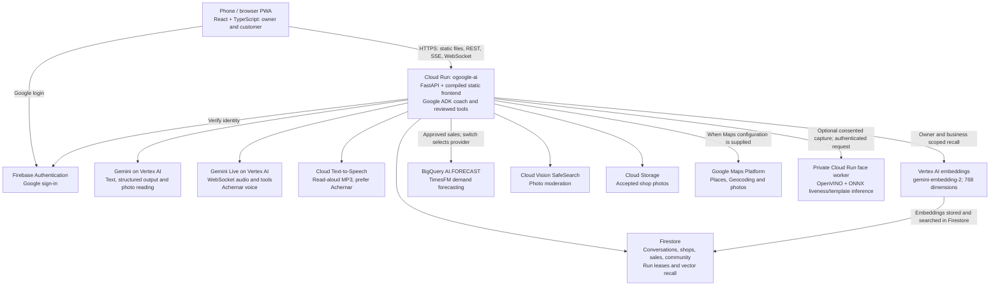

# Chalkboard architecture

Source review: 16 October 2026, checkout `fb483b2`. The diagram shows implemented paths;
configuration and live evidence are recorded separately in [Google AI used](google-ai.md).
No cloud service was contacted for this review.

## Request and data flow

The [Dockerfile](../Dockerfile) builds React and serves its output through
[frontend.py](../backend/app/frontend.py) in the same service as
[FastAPI](../backend/app/main.py). The two public domains share this application;
[router.ts](../src/app/router.ts) selects the owner or customer experience by host/path.
[PWA registration](../src/app/pwa.ts) and [service worker](../public/sw.js) exist;
installation and physical-phone offline behaviour still need device verification.

[ADK](../backend/app/agent.py) runs one `business_coach` agent with tools from
[coordinator.py](../backend/app/coordinator.py), rather than a deployed specialist-agent network.
[streaming.py](../backend/app/streaming.py) streams text over SSE;
[voice.py](../backend/app/voice.py) relays microphone audio, transcriptions, responses and tool
events through Gemini Live. [tts.py](../backend/app/tts.py) separately calls Cloud TTS for
read-aloud; the browser can fall back to its own speech voice. TTS is not a Gemini inference call.

Firebase establishes account identity. Server-side ownership checks scope conversations and
business records; owners review proposed changes before committing them. Firestore adapters
persist [sessions and leases](../backend/app/firestore_memory.py),
[merchant records](../backend/app/merchant_firestore.py) and
[customer/community data](../backend/app/community.py) under `ogoogle_ai_v1` in `ichiropractic`.

[memory_vectors.py](../backend/app/memory_vectors.py) calls Vertex embeddings, then Firestore
`find_nearest` for owner/business conversation recall. This is **Firestore vector search**;
there is no Vertex AI Vector Search endpoint or shared semantic product-search engine in this
checkout. Customer intent uses [Gemini plus catalogue matching](../backend/app/discover_ask.py);
[supplier search](../backend/app/sourcing.py) has its own implementation.

[forecast.py](../backend/app/forecast.py) sends approved sales as parameterized inline data to
BigQuery `AI.FORECAST` using dataset context `ichiropractic.chalkboard_analytics`. It requires
28 recent recorded days per item, returns seven days and falls back to a labelled weekday
average on provider failure. This adapter writes no merchant analytics tables. Sales summaries,
page counts and customer insights are calculated in the app from stored records; a BigQuery
analytics export or Looker dashboard is not implemented here.

[photos.py](../backend/app/photos.py) sanitizes images, calls Vision SafeSearch and Gemini,
and stores accepted media in Cloud Storage. Menus, receipts and day-closing photos are read
by Gemini; see [day_close.py](../backend/app/day_close.py) and [ingestion.py](../backend/app/ingestion.py).
The optional [face worker](../backend/face_worker.py) returns a template after its liveness
checks; [trust.py](../backend/app/trust.py) encrypts it in the shared document store and flags
possible duplicate accounts for review. This uses non-Google inference models and does not
establish business ownership or calibrated fraud-detection accuracy.

## Configuration and boundaries

[settings.py](../backend/app/settings.py) defaults to offline coach, local identity, SQLite,
fixture photo moderation and weekday forecasting. The [local launcher](../scripts/backend-dev.mjs)
enables the product routes with offline fixtures. [runtime-config.py](../deployment/runtime-config.py)
selects Vertex Gemini, Firebase, Firestore, Vision and BigQuery for releases;
[deploy.yml](../.github/workflows/deploy.yml) supplies the private face worker and Maps settings.
These files describe intended release settings, not a fresh inspection of the running revision.

Document AI, Gemini grounding with Google Maps and Recommendations AI serving are absent from
the code reviewed, so they are omitted from the diagram. Existing Maps calls are Places and
Geocoding, not a Gemini grounding tool. Recommendations AI submission placeholder:
**catalog imported; model pending console creation** — supplied task status, with neither import
evidence nor a serving switch/call in this checkout. See the
[pending-services note](google-ai.md#pending-services--not-counted-as-used).

Chalkboard pages and QR sharing do not publish to Google Business Profile. The Google guide
hands off to Google's own pages. Cloud Run storage durability comes from Firestore and Cloud
Storage, not local SQLite or the container filesystem.
