# Customer eye-strain / heatmap audit

16 October 2026, branch `feat/customer-ai-first`. Owner request: "Whenever you read a screen, check
a heat map of the UI components so it is less garbage and less straining on the eyes."

## Method

`tests/heatmap/customer-heatmap.spec.ts` opens every customer screen at **phone 390×844** and
**desktop 1440×1000**, in **light and dark**, and measures what the eye meets in the **first
viewport** (no scrolling). It saves the screenshot with an overlay and the numbers behind it
(`docs/qa/heatmap/{before|after}-{screen}-{phone|desktop}-{light|dark}.jpg` and `data/*.json`);
`node scripts/heatmap-report.mjs` prints the tables below.

| Measure          | What it counts                                                                                                                                                                       | Target                    |
| ---------------- | ------------------------------------------------------------------------------------------------------------------------------------------------------------------------------------ | ------------------------- |
| Overlay          | Each 48-px cell is tinted by how many marks (text runs, icons, images, fields) sit in it: no tint = empty, yellow = 1–2, orange → red = 3–6+. Dashed magenta boxes = targets < 48 px | Calm, few hot cells       |
| Marks / Words    | Visible marks and words in the first viewport                                                                                                                                        | Fewer for the same job    |
| Accents          | Hue families of saturated fills covering > 0.2 % of the viewport (kraft-paper neutrals excluded)                                                                                     | ≤ 2                       |
| Filled actions   | Buttons/links with a saturated fill                                                                                                                                                  | 1 primary action per view |
| Type sizes       | Distinct font sizes on screen                                                                                                                                                        | ≤ 6                       |
| Off-grid spacing | Padding/margin/gap values that are not multiples of 4 px (8-pt grid with a 4-px half step)                                                                                           | 0 in our code             |
| Targets < 48     | Interactive elements under 48×48 (a text field counts by its whole field; inline links in running text excluded)                                                                     | 0                         |
| Contrast         | axe `color-contrast` nodes; every run also runs the full WCAG 2 A/AA axe set                                                                                                         | 0                         |

"Before" is `0078ab9` (origin/main when this work started), measured with the same script in a
temporary worktree against the same local API and the same labelled demo neighbourhood (Tiong
Bahru, `DEMO_WORLD_ENABLED=true`, offline fixtures). Browser emulation, not a physical phone.

## What it found and what changed

| Screen                  | Finding (before)                                                                                                                                                                                                           | Fix (after)                                                                                                                                                                                                                                                                                                                                                                             |
| ----------------------- | -------------------------------------------------------------------------------------------------------------------------------------------------------------------------------------------------------------------------- | --------------------------------------------------------------------------------------------------------------------------------------------------------------------------------------------------------------------------------------------------------------------------------------------------------------------------------------------------------------------------------------- |
| Ask (front door)        | A dashboard: big title, search, four 40-px chips, then the whole Today's 7 deck and Browse below. 5 targets under 48 px. The search field sat mid-screen, far from the thumb.                                              | A conversation: one question, a one-line "what I can do here" with the real shop count, up to 4 chips built from the area's own items/deals/open shops (48 px), one calm Today's 7 card, and the composer pinned above the nav (thumb zone). Marks −7 % phone / −26 % desktop, words −6 % / −32 %, 0 small targets, 1 accent family.                                                    |
| Ask answer              | Three horizontal carousels (Best / Open now / More), every Google place as a full photo card, a 44-px theme/profile pair overlapping the results header.                                                                   | One answer per question: the shop cards (exact item and handwritten price first, then deal or locally made, then open · distance · demo), a mini map with numbered pins, and Google places as a quiet 3-row list. Applied refinements as one grey line ("Cheapest first · Open now"). Follow-up chips only on the latest answer. Sticky header so floating buttons never cover content. |
| Ask answer (trade-off)  | —                                                                                                                                                                                                                          | **More words per first screen (45 → 89 phone)**: each card now carries what the brief asked for (item, price, deal, distance, open now). Density stays spread (no cell above 3 marks), accent families stay ≤ 1 in light; in dark the coral rescue strip and the yellow question bubble make 3. Accepted: rescue is the one feature colour that should pull the eye.                    |
| Shop                    | 8-px side gutter on phones, title squeezed against the theme button, a pink "Demo shop" chip plus a red "closed" dot (two competing warm accents), 40-px Directions/Weekly hours, 36 off-grid spacing values (6 px habit). | 16-px gutter, room for the 48-px theme button, an outlined demo label, a neutral closed dot, 48-px actions, spacing on the 4/8 grid (36 → 14). Accent families 3 → 2 in dark.                                                                                                                                                                                                           |
| Shop chat sheet         | Quick questions (Price / Hours / Location / Ask the owner) at 40 px, a 32-px question field. 48 off-grid values.                                                                                                           | 48-px pill chips and field; spacing 48 → 24 off-grid (the rest are MUI's own chip/field internals).                                                                                                                                                                                                                                                                                     |
| Chat thread             | 40-px shop header link; Send shrank to 43 px when empty.                                                                                                                                                                   | 48-px header link and a steady 48-px Send. Spacing 16 → 10.                                                                                                                                                                                                                                                                                                                             |
| Passport (desktop)      | Five quest-stop links at 36 px.                                                                                                                                                                                            | 48-px pills.                                                                                                                                                                                                                                                                                                                                                                            |
| Chats, Saved            | 6-px and 3-px spacing habit.                                                                                                                                                                                               | On grid where it is our code (Saved 22 → 17, Chats 13 → 9).                                                                                                                                                                                                                                                                                                                             |
| Today's 7 in the thread | First draft repeated its heading ("Here are today's 7…" above "Today near …").                                                                                                                                             | One heading (the deck's own).                                                                                                                                                                                                                                                                                                                                                           |
| Today's 7 entry (dark)  | First draft: a full sunflower card made 3 accent families on the front door.                                                                                                                                               | Neutral card, one small sunflower tile: 2 families in dark, 1 in light.                                                                                                                                                                                                                                                                                                                 |
| Welcome, Browse         | Within targets (Browse's tiles are neutral kraft surfaces, not actions competing).                                                                                                                                         | Unchanged.                                                                                                                                                                                                                                                                                                                                                                              |

Remaining, by design or outside our code: 2-px gaps inside the navigation bar labels, MUI's own
5/6/11/14/16.5-px internals in outlined buttons, chips and text fields, and 8 type sizes on
Passport (its level ring, handwritten level name and stamp book are deliberately expressive).
No contrast or axe violations in any run, before or after.

## Overlays

Phone, light (before → after). Every other combination is in `docs/qa/heatmap/`.

| Screen      | Before                                          | After                                           |
| ----------- | ----------------------------------------------- | ----------------------------------------------- |
| Ask         | 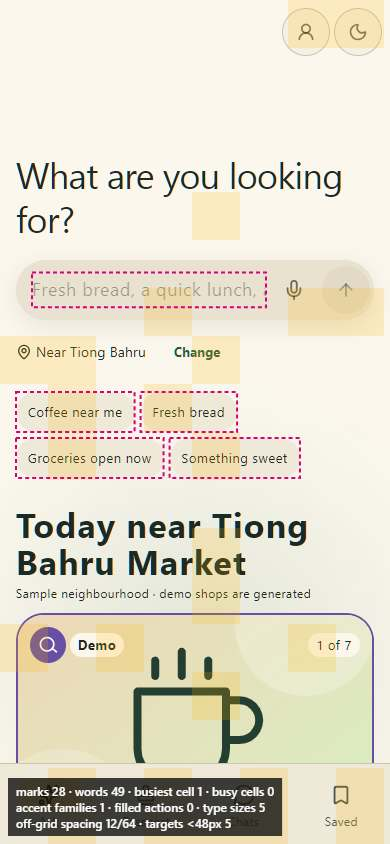         | 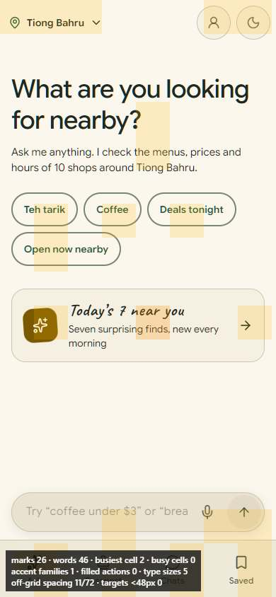          |
| Ask answer  | 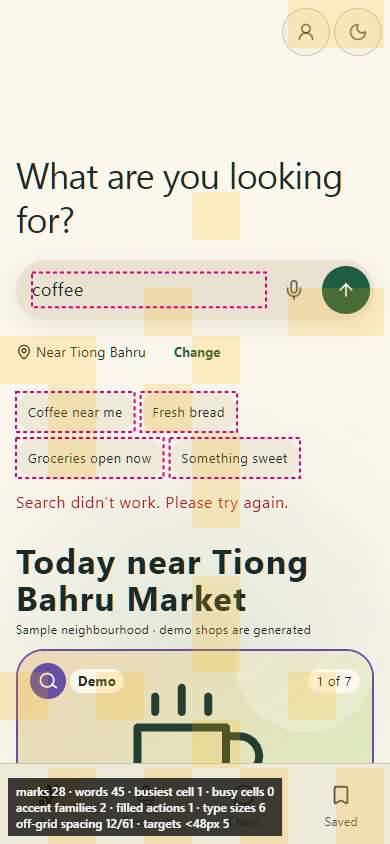 | 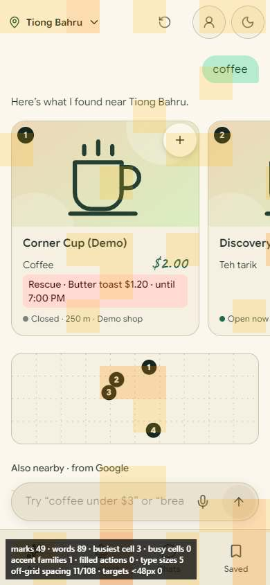  |
| Follow-up   | —                                               | 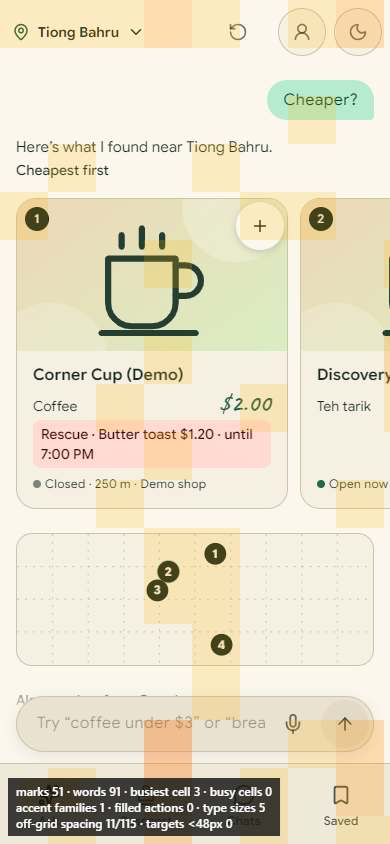 |
| Today's 7   | —                                               | 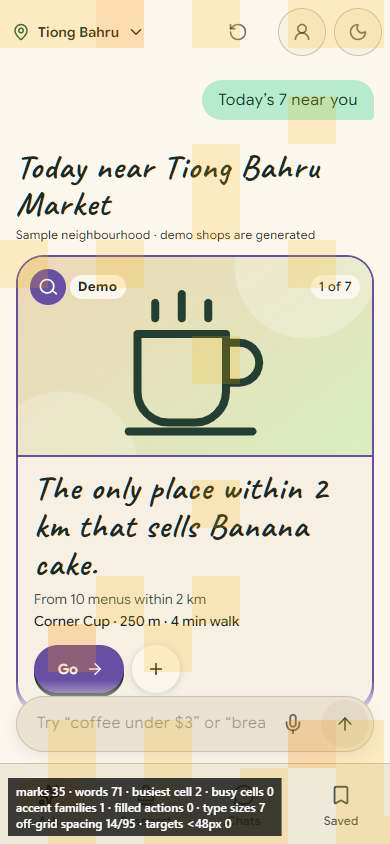    |
| Shop        | 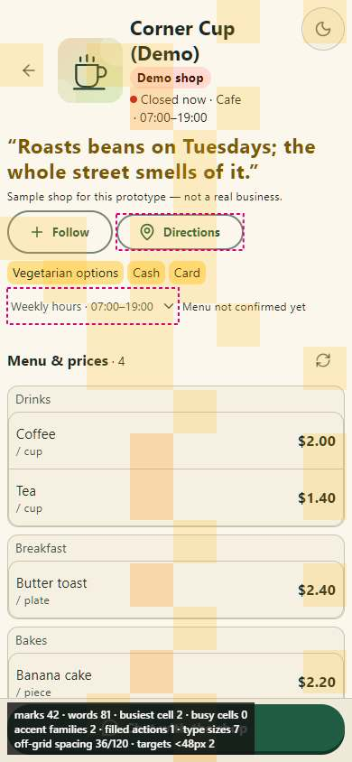        | 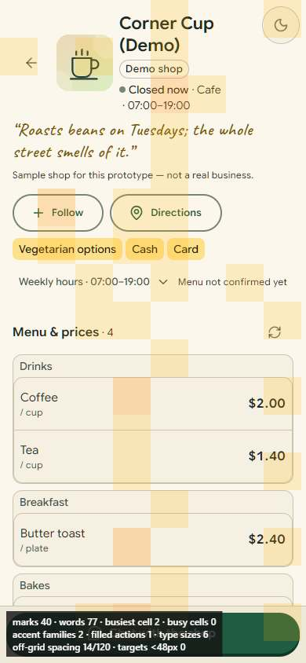         |
| Shop chat   | 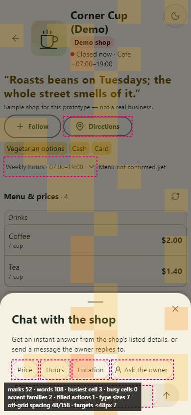   | 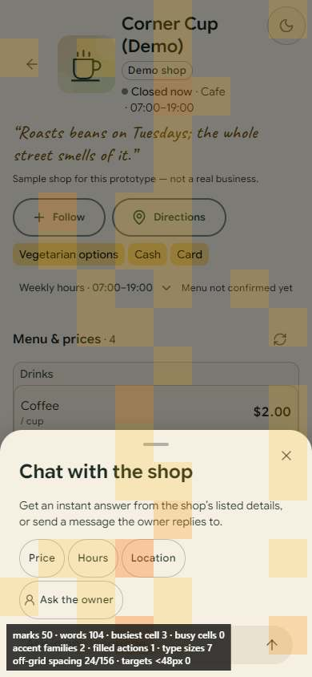    |
| Chat thread | 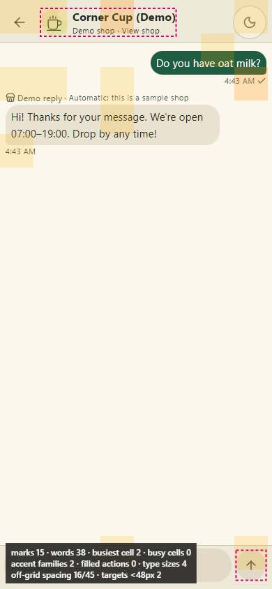 | 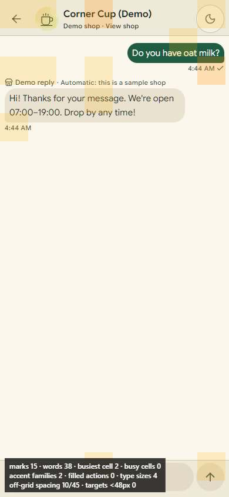  |
| Chats       | 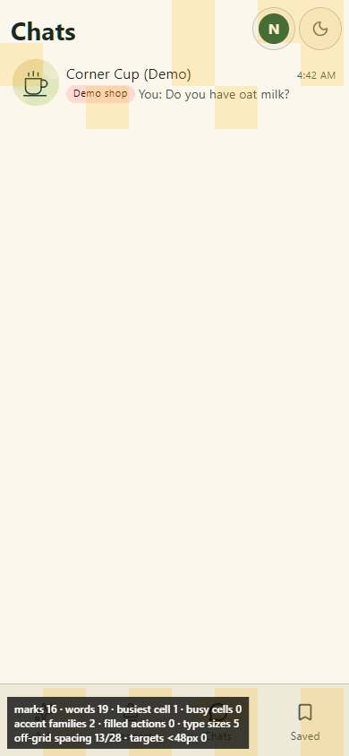       | 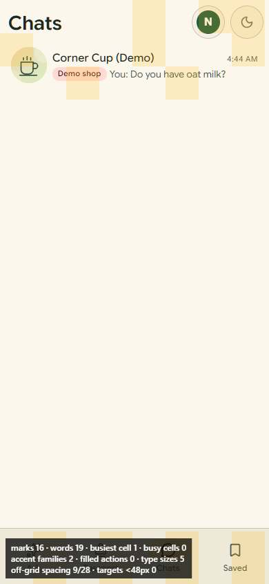        |
| Saved       | 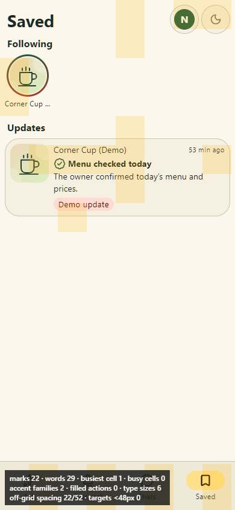       | 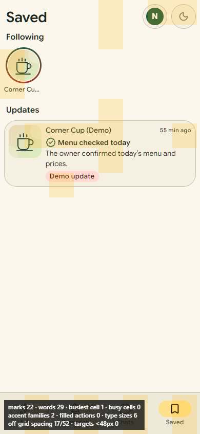        |
| Passport    | 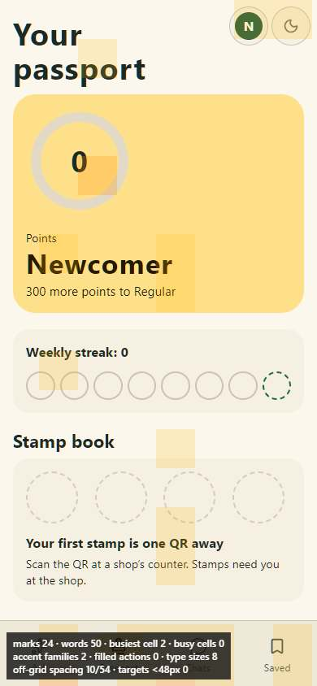    | 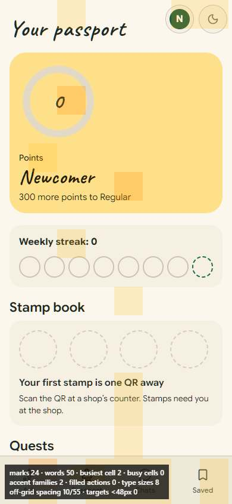     |
| Browse      | 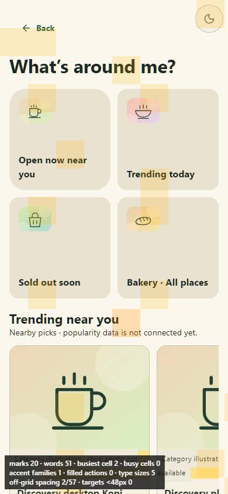      | 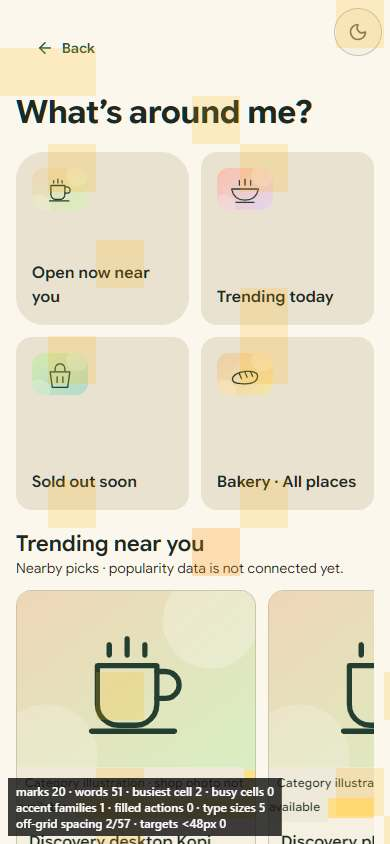       |
| Welcome     | 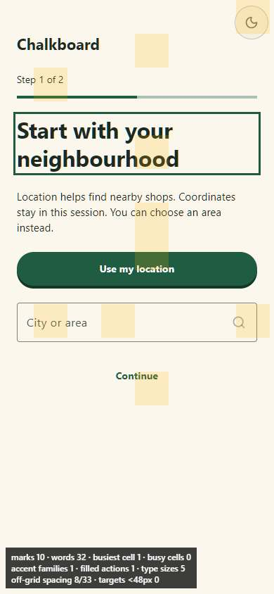     | 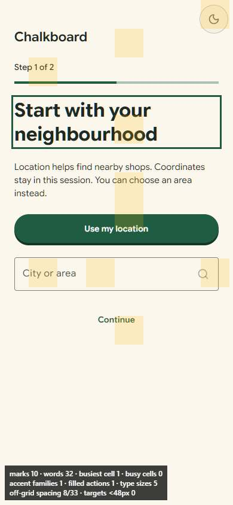      |

## Numbers (before → after; "new" = screen that did not exist before)

Rerun: start the API with `DEMO_WORLD_ENABLED=true` and the web server, then
`HEATMAP_LABEL=after npx playwright test -c tests/heatmap/playwright.config.ts` and
`node scripts/heatmap-report.mjs`.

### phone · light

| Screen       | Marks    | Words     | Accents | Filled actions | Type sizes | Off-grid spacing | Targets < 48 | Contrast |
| ------------ | -------- | --------- | ------- | -------------- | ---------- | ---------------- | ------------ | -------- |
| ask          | 28 → 26  | 49 → 46   | 1       | 0              | 5          | 12 → 11          | 5 → 0        | 0        |
| ask-followup | new · 51 | new · 91  | new · 1 | new · 0        | new · 5    | new · 11         | new · 0      | new · 0  |
| ask-results  | 28 → 49  | 45 → 89   | 2 → 1   | 1 → 0          | 6 → 5      | 12 → 11          | 5 → 0        | 0        |
| ask-today    | new · 35 | new · 71  | new · 1 | new · 0        | new · 7    | new · 14         | new · 0      | new · 0  |
| browse       | 20       | 51        | 1       | 0              | 5          | 2                | 0            | 0        |
| chat-thread  | 15       | 38        | 2       | 0              | 4          | 16 → 10          | 2 → 0        | 0        |
| chats        | 16       | 19        | 2       | 0              | 5          | 13 → 9           | 0            | 0        |
| passport     | 24       | 50        | 2       | 0              | 8          | 10               | 0            | 0        |
| saved        | 22       | 29        | 2       | 0              | 6          | 22 → 17          | 0            | 0        |
| shop-chat    | 52 → 50  | 108 → 104 | 2       | 1              | 7          | 48 → 24          | 7 → 0        | 0        |
| shop         | 42 → 40  | 81 → 77   | 2       | 1              | 7 → 6      | 36 → 14          | 2 → 0        | 0        |
| welcome      | 10       | 32        | 1       | 1              | 5          | 8                | 0            | 0        |

### phone · dark

| Screen       | Marks    | Words     | Accents | Filled actions | Type sizes | Off-grid spacing | Targets < 48 | Contrast |
| ------------ | -------- | --------- | ------- | -------------- | ---------- | ---------------- | ------------ | -------- |
| ask          | 28 → 26  | 49 → 46   | 1 → 2   | 0              | 5          | 12 → 11          | 5 → 0        | 0        |
| ask-followup | new · 51 | new · 91  | new · 3 | new · 0        | new · 5    | new · 11         | new · 0      | new · 0  |
| ask-results  | 28 → 49  | 45 → 89   | 2 → 3   | 1 → 0          | 6 → 5      | 12 → 11          | 5 → 0        | 0        |
| ask-today    | new · 35 | new · 71  | new · 3 | new · 0        | new · 7    | new · 14         | new · 0      | new · 0  |
| browse       | 20       | 51        | 1       | 0              | 5          | 2                | 0            | 0        |
| chat-thread  | 15       | 38        | 2       | 0              | 4          | 16 → 10          | 2 → 0        | 0        |
| chats        | 16       | 19        | 3       | 0              | 5          | 13 → 9           | 0            | 0        |
| passport     | 24       | 50        | 3       | 0              | 8          | 10               | 0            | 0        |
| saved        | 22       | 29        | 3       | 0              | 6          | 22 → 17          | 0            | 0        |
| shop-chat    | 52 → 50  | 108 → 104 | 3 → 2   | 1              | 7          | 48 → 24          | 7 → 0        | 0        |
| shop         | 42 → 40  | 81 → 77   | 3 → 2   | 1              | 7 → 6      | 36 → 14          | 2 → 0        | 0        |
| welcome      | 10       | 32        | 1       | 1              | 5          | 8                | 0            | 0        |

### desktop · light

| Screen       | Marks    | Words     | Accents | Filled actions | Type sizes | Off-grid spacing | Targets < 48 | Contrast |
| ------------ | -------- | --------- | ------- | -------------- | ---------- | ---------------- | ------------ | -------- |
| ask          | 35 → 26  | 68 → 46   | 1       | 0              | 5          | 14 → 11          | 5 → 0        | 0        |
| ask-followup | new · 62 | new · 102 | new · 1 | new · 0        | new · 4    | new · 11         | new · 0      | new · 0  |
| ask-results  | 34 → 59  | 71 → 99   | 1       | 1 → 0          | 6 → 4      | 14 → 11          | 5 → 0        | 0        |
| ask-today    | new · 43 | new · 93  | new · 1 | new · 1        | new · 7    | new · 17         | new · 0      | new · 0  |
| browse       | 46       | 104       | 1       | 1              | 6          | 20               | 0            | 0        |
| chat-thread  | 15       | 38        | 1       | 0              | 3          | 16 → 10          | 2 → 0        | 0        |
| chats        | 16       | 19        | 1       | 0              | 5          | 13 → 9           | 0            | 0        |
| passport     | 40 → 37  | 95 → 87   | 2       | 0              | 8          | 12 → 11          | 5 → 0        | 0        |
| saved        | 22       | 29        | 1       | 0              | 6          | 22 → 17          | 0            | 0        |
| shop-chat    | 65 → 64  | 155 → 144 | 2       | 2              | 7          | 50 → 26          | 7 → 0        | 0        |
| shop         | 55 → 54  | 128 → 117 | 2       | 2              | 7          | 38 → 16          | 2 → 0        | 0        |
| welcome      | 10       | 32        | 1       | 1              | 4          | 8                | 0            | 0        |

### desktop · dark

| Screen       | Marks    | Words     | Accents | Filled actions | Type sizes | Off-grid spacing | Targets < 48 | Contrast |
| ------------ | -------- | --------- | ------- | -------------- | ---------- | ---------------- | ------------ | -------- |
| ask          | 35 → 26  | 68 → 46   | 1 → 0   | 0              | 5          | 14 → 11          | 5 → 0        | 0        |
| ask-followup | new · 62 | new · 102 | new · 3 | new · 0        | new · 4    | new · 11         | new · 0      | new · 0  |
| ask-results  | 34 → 59  | 71 → 99   | 1 → 3   | 1 → 0          | 6 → 4      | 14 → 11          | 5 → 0        | 0        |
| ask-today    | new · 43 | new · 93  | new · 3 | new · 1        | new · 7    | new · 17         | new · 0      | new · 0  |
| browse       | 46       | 104       | 1       | 1              | 6          | 20               | 0            | 0        |
| chat-thread  | 15       | 38        | 1       | 0              | 3          | 16 → 10          | 2 → 0        | 0        |
| chats        | 16       | 19        | 1       | 0              | 5          | 13 → 9           | 0            | 0        |
| passport     | 40 → 37  | 95 → 87   | 3       | 0              | 8          | 12 → 11          | 5 → 0        | 0        |
| saved        | 22       | 29        | 1       | 0              | 6          | 22 → 17          | 0            | 0        |
| shop-chat    | 65 → 64  | 155 → 144 | 2       | 2              | 7          | 50 → 26          | 7 → 0        | 0        |
| shop         | 55 → 54  | 128 → 117 | 2       | 2              | 7          | 38 → 16          | 2 → 0        | 0        |
| welcome      | 10       | 32        | 1       | 1              | 4          | 8                | 0            | 0        |
