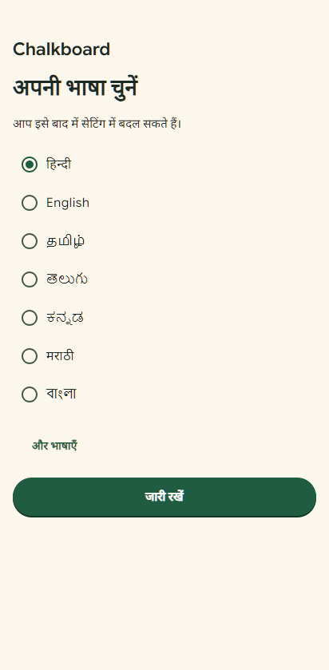
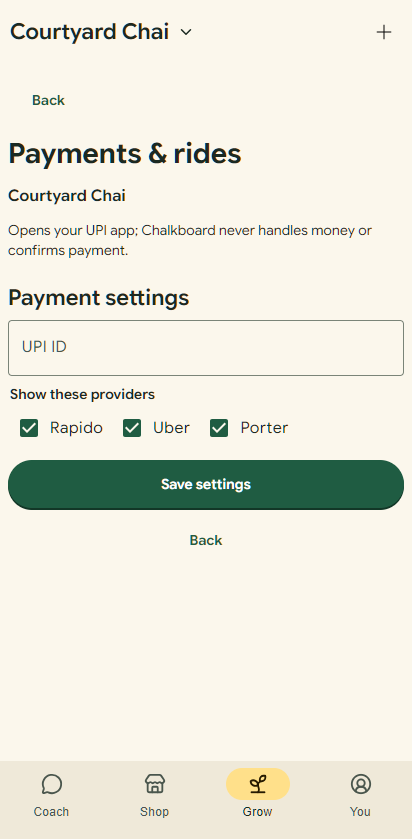
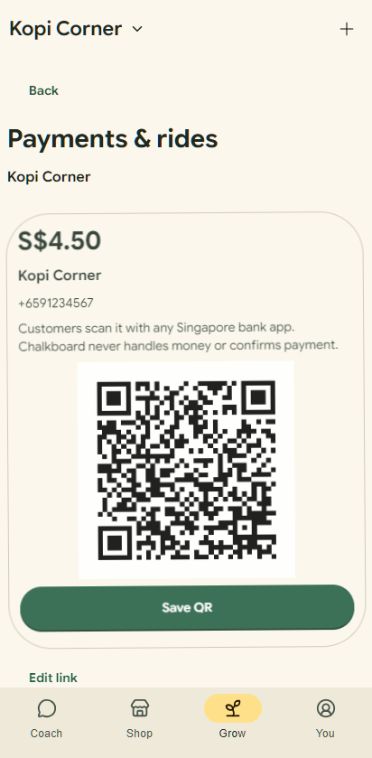

# Region persona: the shop's location decides money, language, payments and flows

Brief: `docs/briefs/task-REGION-PERSONA.md` (issues #75, #77). Branch `fix/sg-languages-e2e`.

## One region profile

`src/region/regions.json` is the single source for both sides: `backend/app/region.py` reads the
same file (the Dockerfile copies it next to the module), and `src/region/region.ts` imports it.

| Region    | Money                        | Languages offered (first = default)                                                            | Payments                                       | Rides / delivery                       | Tax wording |
| --------- | ---------------------------- | ---------------------------------------------------------------------------------------------- | ---------------------------------------------- | -------------------------------------- | ----------- |
| India     | INR, ₹, 1,00,000 grouping    | Hindi (or the area's: Bengaluru → Kannada…), English, Tamil, Telugu, Kannada, Marathi, Bengali | UPI QR / deep link, Paytm, PhonePe, card, cash | Rapido, Uber, Porter; Swiggy, Zomato   | GST         |
| Singapore | SGD, S$                      | English, 简体中文, Bahasa Melayu, தமிழ்                                                        | PayNow QR (SGQR), NETS, card, GrabPay, cash    | Grab, Gojek, Lalamove; Grab, foodpanda | GST 9%      |
| Elsewhere | the phone country's currency | English, then the phone's language                                                             | card, cash (no payment QR)                     | Uber                                   | none        |

How the region is found:

- **Owner:** the shop's pin (known country bounds), then its saved timezone, then its saved
  currency, then the phone (timezone, then the region in its language tags).
- **Customer:** their chosen area or GPS, then the phone.
- **New shop:** the pin decides currency and timezone; with no pin, the phone's zone
  (`X-Client-Timezone`). The old `currency="SGD"` / `timezone="Asia/Singapore"` defaults in
  `merchant.py` are gone (#75). Older records that left Singapore time out still read back as
  Singapore.

Places that read the profile: price formatting (`format.ts`, symbol and grouping from the
currency's home country so rupees always group as 1,00,000), shop details suggestions for payment
and delivery (`factNames.ts`), Payments & rides (UPI for India, PayNow for Singapore, the
region's ride apps), the Ask placeholder and examples ("coffee under S$3", "chai under ₹30"), the
customer map's starting area (Indiranagar for an Indian phone, never Tiong Bahru), the morning
brief, rescue tile, tour, public shop page and every AI prompt (`region.region_rule`: currency,
payments, units, examples).

## Language after sign-in

`src/features/language/LanguageStep.tsx`: one "Choose your language" screen right after sign-in,
for owners (before consent; guessed from their shop's pin when they already have one) and
customers (a full-screen dialog over the page, so a message being written carries on). The best
guess is preselected and the screen's own words follow the selection; one tap on Continue
confirms. "More languages" lists the rest. It is stored once as the app's single language
preference (`niva.starter.preferences` plus `niva.language.chosen`), changeable later in You, and
voice reads the same preference (#55).

Default: the phone's language when the region speaks it; else the area's language; else the
region's first (India → Hindi, Singapore → English). English is always offered.

## Findings

| #   | Where                      | Finding                                                                                                    | Status                                                                                            |
| --- | -------------------------- | ---------------------------------------------------------------------------------------------------------- | ------------------------------------------------------------------------------------------------- |
| 1   | `merchant.py`              | New shops defaulted to SGD and Asia/Singapore, so an Indian shop without a currency was priced in S$ (#75) | **Fixed:** pin, then phone                                                                        |
| 2   | `format.ts` `shopCurrency` | A shop saved without a currency read as SGD                                                                | **Fixed:** its region's currency                                                                  |
| 3   | Ask placeholder            | "coffee under $3" for everyone; the Tamil and Hindi ones always said ₹50 even in Singapore                 | **Fixed:** `{price}` from the region (S$3, ₹30)                                                   |
| 4   | Customer map start         | An Indian phone opened on Tiong Bahru                                                                      | **Fixed:** the phone region's sample area                                                         |
| 5   | Payments & rides           | UPI only; a Singapore shop saw "UPI uses INR"                                                              | **Fixed:** PayNow QR (SGQR payload, same CRC as `payments.py`) for Singapore, Grab/Gojek/Lalamove |
| 6   | Shop details suggestions   | Payment and delivery suggestions followed the phone, not the shop                                          | **Fixed:** the shop's region                                                                      |
| 7   | Prices                     | SGD printed as "$1.80" (or "SGD 2.20" on cards)                                                            | **Fixed:** "S$1.80" everywhere; four older specs updated to expect S$                             |
| 8   | AI prompts                 | No region: replies could quote S$ to an Indian shop                                                        | **Fixed:** `region_rule` in the coach, Ask, customer chat, recap and playbook prompts             |
| 9   | Sign-in                    | No language step; the language followed the phone only                                                     | **Fixed:** the step above, owner and customer                                                     |
| 10  | Chrome on an Indian phone  | Reports `Asia/Calcutta`, not `Asia/Kolkata`                                                                | OK: both map to India                                                                             |

## Tests

- `backend/tests/test_region.py`: pin → country (India cities, Singapore, Johor Bahru, Kathmandu,
  Dhaka, Colombo, Lahore, Tokyo), India / Singapore / fallback profiles, money text, new-shop
  defaults never Singapore in India, PayNow payload and CRC, region rule in prompts, the four
  Singapore languages pinned, offline area samples in Mandarin, Malay and Tamil.
- `tests/region.spec.ts` (phone and desktop): India owner (Hindi preselected with English and
  Tamil, no Malay; ₹18.00; UPI; Rapido/Uber/Porter), India customer never sees S$/SGD/Tiong
  Bahru, Singapore owner (English with 中文/Melayu/தமிழ்; S$1.80; PayNow validation and QR;
  Grab/Gojek/Lalamove), Singapore customer language step after sign-in, remembered after reload.
- Full UI suite on the phone project, `--workers=1`: all passed (after the S$ expectation
  updates). Backend: 1043 passed, 247 skipped.

Screenshots: `docs/qa/region/`.

| India language step                                       | India payments                                  | Singapore PayNow                                    |
| --------------------------------------------------------- | ----------------------------------------------- | --------------------------------------------------- |
|  |  |  |

## Forwarded

- `NewShopFlow.tsx` / `NewShopStage.tsx` / `voice.py` / the onboarding section of `agent.py` were
  not touched. Nothing in them needs to change for the region: they read the shop draft, whose
  currency and timezone now come from the backend.
- Not covered: countries other than India and Singapore get the generic profile (currency from
  the phone, card and cash, English first).
