# Production Rubric & 5-Minute Judge Audit (Phone 390px)

**Audit Date:** 18 October 2026  
**Viewport:** 390 × 844 px (iPhone 14 / modern standard phone)  
**Targets Tested:**  
- Customer Hub / Landing: `https://chalkboard.shreyaan.work`  
- Merchant App / Business Hub: `https://business.chalkboard.shreyaan.work`  
- Architecture & Tech Evidence: `https://chalkboard.shreyaan.work/architecture`  
**Governing Documents:** `docs/HACKATHON-REVIEW.md`, `docs/OWNER-NOTES.md`, `C:/Users/pshre/work/orchestrator-tools/PHONE-UX-RULES.md`

---

## 1. Executive Summary

A judge evaluating Chalkboard in **5 minutes** experiences a visually distinct, thoughtful product with undeniable depth in Google AI technologies (Gemini 3.5 Flash, Gemini Live voice, embeddings memory, TimesFM BigQuery forecasting, Maps grounding, Vision SafeSearch). 

However, critical production gaps and phone-first layout defects immediately impede an unauthenticated judge:
1. **Public Demo Crash (#241):** Navigating to `/demo` or `/explore/demo` (linked via "Try demo" in top bars) crashes with HTTP 404 `{"detail":"DEMO_DISABLED"}`.
2. **Google OAuth Hard Gate:** An unauthenticated judge attempting to walk the merchant flow on `business.chalkboard.shreyaan.work` is stopped by a mandatory Google sign-in; no guest walkthrough or sandbox preview is available on the live production domain.
3. **Severe Phone Layout Occlusions (#242, #243):** Floating buttons and sticky bars directly obscure critical content at 390px (e.g. the green "Chat with the shop" button occludes menu items in the middle of the shop page; the bottom navigation bar covers the "Today's 7" card).
4. **Empty State & Placeholder Failures (#244, #245):** Customer Browse (`/explore/browse`) and Passport (`/explore/passport`) render blank cards or completely empty screens.
5. **Industry Realism Mismatch (#252):** A small neighborhood tea stall / kopitiam is shown transacting complex enterprise SAP IDoc XML (`ORDERS05`), violating industry realism guidelines (Rule 11).

### Hackathon Score Card Today vs Target

| Rubric Criterion | Weight | Today's Score | Target Score | Point Gap | Primary Bottlenecks |
| :--- | :---: | :---: | :---: | :---: | :--- |
| **Technical Merit & GenAI** | 40% | **28 / 40** (70%) | **38 / 40** | **+10 pts** | Multi-agent ADK architecture and TimesFM BigQuery models are implemented on backend but hidden from the judge without visible in-app attribution badges; demo workspace disabled in prod. |
| **Problem Alignment & Impact** | 25% | **16 / 25** (64%) | **24 / 25** | **+8 pts** | Lack of in-app impact telemetry (time saved, accuracy numbers); unauthenticated judges cannot see the full merchant lifecycle without Google sign-in. |
| **Innovation** | 25% | **18 / 25** (72%) | **23 / 25** | **+5 pts** | Voice-first onboarding, closing-time rescue radar, and SAP IDoc supply chain translation are highly innovative, but SAP IDoc on a corner tea stall strains domain credibility. |
| **User Experience (UX)** | 10% | **5.5 / 10** (55%) | **9.5 / 10** | **+4 pts** | Floating button occlusions, blank placeholder cards, misleading "Step 1 of 5" on login screen, and false "QR out of date" warnings on valid scans. |
| **Total Score** | **100%** | **67.5 / 100** | **94.5 / 100** | **+27 pts** | **Strong Top-Tier Contender once Top 10 Fixes land** |

---

## 2. Five-Minute Judge Walkthrough

Below is the step-by-step record of what a judge experiences walking the 10 core milestones sequentially on production at 390px.

### Step 1: Landing Page (`https://chalkboard.shreyaan.work`)
- **What Judge Sees:**
  - Hero headline: *"Small shops. Big neighbourhood energy."*
  - Dual prominent CTAs: full-width primary button *"Find places near me"* (48px height) and secondary outlined button *"For businesses"*.
  - An interactive phone mockup showing live price adjustments and sold-out updates (*"Kopi is $1.80 now, kaya toast sold out"*).
  - 3-step value proposition: *Send a photo*, *Talk it through*, *Share your page*.
  - Fan of 5 sample shops (*Ah Seng Kopi*, *Rotiboy Corner*, *Glow Hair Studio*, *Menya Hoshi*, *Som Tam Nong*).
- **What Judge Misses / Is Confused By:**
  - The 5 shop cards at the bottom are static decorative elements (`.lp-fan`), not clickable links. Tapping them yields no reaction.
  - The landing page emphasizes simple catalog publishing, omitting the rich supply chain, agent-to-agent negotiation, and predictive demand planning features that carry 40% of the rubric score.
- **Visual Evidence:** `docs/qa/rubric-audit/01_landing.png`
- **Phone UX Rules:** Passed (Rule 1, 2, 5).

### Step 2: For Business (`https://business.chalkboard.shreyaan.work`)
- **What Judge Sees:**
  - Clean hero: *"Your shop, online in one conversation"*.
  - Primary button: *"Continue with Google"*, followed by *"How it works"* and *"Get started"*.
- **What Judge Misses / Is Confused By:**
  - **Issue #204:** A *"Step 1 of 5"* progress bar is displayed at the very top of an unauthenticated sign-in screen, confusing users who have not yet started onboarding.
  - **Issue #241 (Major):** Unauthenticated judges have no guest access or demo button. Clicking *"Continue with Google"* launches an OAuth popup requiring personal credentials.
  - If a judge manually enters `/demo` or `/explore/demo`, the application crashes with an error banner: *"The demo could not open. Try again."* because backend returns HTTP 404 `{"detail":"DEMO_DISABLED"}`.
- **Visual Evidence:** `docs/qa/rubric-audit/02_business_landing.png`, `04_demo.png`
- **Phone UX Rules:** Violated Rule 8 (Broken demo state with no fallback).

### Step 3: Onboarding by Typing
- **What Judge Sees (in preview/authenticated flow):**
  - Full-screen conversational AI coach (*"Let's open your shop"*).
  - The AI speaks first and prompts for the shop name, then derives business profile questions (category, location, operating hours, items).
  - Real-time cart/shop card updates on the fly as entities are extracted from plain text.
- **What Judge Misses / Is Confused By:**
  - Voice mode requires microphone permissions; when disabled, the prompt gracefully falls back to text entry, but audio waveform indicators still linger briefly.
  - On Cloud Run, judges unable to log into Google cannot experience this conversational flow live without running local fixtures.
- **Visual Evidence:** `docs/qa/rubric-audit/11_onboarding_chat.png`
- **Phone UX Rules:** Passed (Rule 7, 9).

### Step 4: Shop Live
- **What Judge Sees:**
  - Confirmation milestone screen (*"Congratulations, your shop is live"*).
  - Complete digital storefront with catalog items, prices, and one-tap sold-out switches.
  - Shareable customer link and on-screen printable QR code poster.
- **What Judge Misses / Is Confused By:**
  - Demo shops display a persistent *"Menu not confirmed yet"* badge, which may lead a judge to question whether the shop is truly live.
- **Visual Evidence:** `docs/qa/rubric-audit/31_demo_shop_page.png`
- **Phone UX Rules:** Passed (Rule 1, 2).

### Step 5: Today Tab (Coach & Daily Operations)
- **What Judge Sees:**
  - Personal daily greeting and coach line.
  - Operational metrics pulse: yesterday's sales, customer search traffic, regular customer stamps, and demand forecast.
  - Actionable *"Needs you now"* cards (prep plan recommendations, low stock alerts, closing-time rescue discounts).
- **What Judge Misses / Is Confused By:**
  - **Issue #214:** The top greeting headline is vertically clipped by the sticky top app bar on initial mobile page load.
  - The demand forecast is powered by BigQuery `AI.FORECAST` (TimesFM), but there is no chip or attribution badge in the UI informing the judge that Google TimesFM is generating the projection.
- **Visual Evidence:** `docs/qa/rubric-audit/06_architecture.png` (demonstrating technical backend integration).
- **Phone UX Rules:** Violated Rule 3 (Vertical clipping of greeting).

### Step 6: Grow Tab (Features & Expansion)
- **What Judge Sees:**
  - Hub for merchant expansion tools: *Get on Google*, *Payments & rides*, *Connect your system*, *Supplier radar*, *Group buying*, and *Price check*.
  - Clean cards linking to deep features.
- **What Judge Misses / Is Confused By:**
  - **Issue #211:** The *Payments & rides* tile displays a hardcoded Indian Rupee (`₹`) symbol even when viewing Singapore or other non-INR businesses.
  - *Connect your system* is presented as an automated POS connector, but functions as a Gemini CSV/export mapper.
- **Visual Evidence:** `docs/qa/rubric-audit/06_architecture.png`
- **Phone UX Rules:** Violated Rule 7 (Currency consistency).

### Step 7: Purchase Orders & Supply Chain
- **What Judge Sees:**
  - Linked supply chain loop: Forecasted shortage → Draft PO → Approval → Order confirmation (`ORDRSP`) → Dispatch notice (`DESADV`) → Electronic Invoice (`INVOIC`).
  - Interactive *"View as SAP (IDoc)"* modal displaying formatted EDI/XML (`ORDERS05`) alongside plain-language translation.
  - Supplier simulation buttons allowing judges to trigger mock supplier responses and track order arrival.
- **What Judge Misses / Is Confused By:**
  - **Issue #252 (Industry Realism Mismatch):** Showing a micro-business tea stall or neighborhood kopitiam processing SAP IDoc XML violates `PHONE-UX-RULES.md` Rule 11. Small merchants order via WhatsApp or phone; SAP IDoc is an enterprise standard for supermarket chains and distributors.
  - **Issue #210 & #212:** PO numbers wrap awkwardly across lines, and undefined credit terms occasionally appear.
- **Visual Evidence:** `tests/agy/supply-chain.spec.ts`
- **Phone UX Rules:** Violated Rule 11 (Industry realism).

### Step 8: Customer Explore (`https://chalkboard.shreyaan.work/explore`)
- **What Judge Sees:**
  - AI concierge front door: *"What are you looking for nearby?"*
  - Floating bottom chat dock: *"Try 'coffee under ₹30' or 'bread open now'"* with microphone and submit buttons.
  - Area switcher (Indiranagar / Tiong Bahru).
  - Bottom navigation bar: *Ask*, *Rescue*, *Passport*, *Chats*, *Saved*.
- **What Judge Misses / Is Confused By:**
  - **Issue #243 (Severe Overlap):** The fixed bottom navigation bar floats directly over the *"Today's 7 near you"* card and *"Browse everything nearby"* link, cutting off text and touch targets.
  - **Issue #244:** The *"Near you now"* section renders 2 completely blank white rounded rectangle outlines without text or images.
  - Navigating to `/explore/browse` shows 5 blank cards with empty borders (`23_customer_browse.png`).
  - Tapping *"Today's 7"* opens a screen stating *"Quiet here so far. Try a nearby area"* with no recommendations (`13_todays_7_feed.png`).
  - Area selector text input label clips into its border (`17_area_selector.png`).
- **Visual Evidence:** `docs/qa/rubric-audit/03_customer_explore.png`, `13_todays_7_feed.png`, `17_area_selector.png`, `23_customer_browse.png`
- **Phone UX Rules:** Violated Rule 3, Rule 4, Rule 8.

### Step 9: Customer Shop Page (`/explore/s/demo-katong-kopitiam`)
- **What Judge Sees:**
  - Verified shop banner, category, hours, badges (*Cash*, *PayNow*, *NETS*).
  - Menu catalog with prices and sold-out indicators.
  - Interactive loyalty stamp card (*2 of 10 stamps collected*).
  - Tier rewards and neighbor reviews with ratings.
- **What Judge Misses / Is Confused By:**
  - **Issue #242 (Critical UX):** A dark green *"Chat with the shop"* button floats right in the middle of the viewport over menu items (*"Milo dinosaur"*, *"Kaya toast set"*), completely obscuring item names and prices.
  - The chips row at the top has a cut-off chip on the right screen edge without a scroll cue.
  - *"Similar nearby"* cards at the bottom are blank grey placeholders.
- **Visual Evidence:** `docs/qa/rubric-audit/31_demo_shop_page.png`
- **Phone UX Rules:** Violated Rule 1, Rule 3.

### Step 10: QR Stamp Scan
- **What Judge Sees:**
  - Tapping *"Try a demo stamp"* opens an educational bottom sheet explaining the 3-step loyalty mechanic.
  - Visiting with `?source=qr&k=demo-stamp-key` advances the customer's stamp count from 2 to 3.
- **What Judge Misses / Is Confused By:**
  - **Issue #249:** Scanning the demo QR key successfully increments the stamp card, but simultaneously pops up an alert sheet claiming: *"This QR is out of date. Ask the shop to print its new QR."* This alarms judges into thinking the transaction failed when it succeeded.
  - Console logs an unhandled HTTP 403 error during stamp verification.
- **Visual Evidence:** `docs/qa/rubric-audit/32_demo_shop_stamp_moment.png`, `33_qr_stamp_scanned.png`
- **Phone UX Rules:** Violated Rule 8 (Confusing error feedback on successful action).

---

## 3. Rubric Evaluation Table

Detailed analysis against the hackathon judging rubric from `docs/HACKATHON-REVIEW.md`:

| Criterion & Weight | Current Score | What a Judge Sees | What a Judge Misses / Is Confused By | Points to Recover |
| :--- | :---: | :--- | :--- | :---: |
| **Technical Merit & GenAI** *(40%)* | **28 / 40** | • Gemini 3.5 Flash chat & entity extraction. • Gemini Live voice streaming integration. • Vision SafeSearch photo moderation. • Maps grounding & geocoding. • Comprehensive architecture page (`/architecture`) outlining Cloud Run, BigQuery, Firestore, and Document AI. | • **BigQuery TimesFM forecast is invisible:** Although TimesFM runs on the backend, the UI simply calls it "demand forecast" without showing judges that Google BigQuery AI.FORECAST is driving the predictions. • **No visible multi-agent ADK badge:** The coordinator + specialist agent design (onboarding, analyst, buyer, concierge) is not surfaced in the UI. • **Demo API 404 (#241):** Cloud Run backend refuses public demo workspace requests (`DEMO_DISABLED`), preventing judges from running live test suites. | **+10 pts** |
| **Problem Alignment & Impact** *(25%)* | **16 / 25** | • Addresses small merchant digitization end-to-end (listing, sales, close-the-day, rescue deals, supplier ordering). • Local neighborhood customer discovery. • Multilingual support across 15 languages. | • **No measured impact metrics in-app:** Judges look for quantitative evaluation (e.g. "93% menu photo parsing accuracy", "onboarding time reduced from 15 min to 90 seconds"). • **Unauthenticated access blocked:** Unauthenticated judges cannot experience the merchant problem-solving journey without personal Google sign-in. | **+8 pts** |
| **Innovation** *(25%)* | **18 / 25** | • Voice-first shop onboarding with real-time cart extraction. • Closing-time rescue radar (hyperlocal food waste prevention). • Multi-party supply chain document translation (SAP IDoc ↔ plain language). • Coalition neighborhood stamp card / passport. | • **Realism violation (#252):** Small tea stall exchanging SAP IDocs feels artificial rather than practical innovation; needs framing as enterprise distributor simulation. • **Agent-to-Agent (A2A) shopping hand-off is buried:** The customer concierge asking shop agents for holds is conceptually strong but lacks a prominent guided demo in the UI. | **+5 pts** |
| **User Experience (UX)** *(10%)* | **5.5 / 10** | • Material Design 3 base with custom Chalkboard visual identity. • Smooth GSAP micro-animations. • Dark and light mode toggle. • Dedicated mobile thumb zone buttons. | • **Floating button occlusions (#242, #243):** Floating "Chat with the shop" blocks menu items; bottom nav bar covers "Today's 7" card. • **Misleading Step 1 of 5 (#204):** Sign-in screen shows step indicator before login. • **Empty card placeholders (#244, #245):** Browse and Passport render blank outlines. • **False "QR out of date" warning (#249):** Appears on successful stamp scan. | **+4 pts** |
| **TOTAL** | **67.5 / 100** | | | **+27 pts** |

---

## 4. Top 10 Fixes Ranked by Rubric Points Impact

These 10 targeted remediations represent the highest return-on-investment for rubric scoring before final submission:

```mermaid
graph TD
    Fix1["1. Enable Public Demo on Prod (#241) [+7 pts]"] --> Win["High Total Score (+27 pts)"]
    Fix2["2. Fix Floating Chat Button Occlusion (#242) [+3 pts]"] --> Win
    Fix3["3. Fix Bottom Nav Overlap (#243) [+3 pts]"] --> Win
    Fix4["4. In-App GenAI Badges for TimesFM & ADK [+3 pts]"] --> Win
    Fix5["5. Populate Browse Cards & Skeletons (#244) [+2 pts]"] --> Win
    Fix6["6. Render Passport Stamps & Perks (#245) [+2 pts]"] --> Win
    Fix7["7. Fix False QR Out-of-Date Warning (#249) [+2 pts]"] --> Win
    Fix8["8. Add In-App Impact & Evaluation Telemetry [+2 pts]"] --> Win
    Fix9["9. Contextualize SAP IDoc for Industry Realism (#252) [+2 pts]"] --> Win
    Fix10["10. Remove Misleading Step 1 of 5 on Sign-In (#204) [+1 pt]"] --> Win
```

| Rank | Issue / Task | Rubric Area | Points Gain | Problem & Concrete Remediation |
| :---: | :--- | :--- | :---: | :--- |
| **1** | **#241: Enable Public Demo / Workspace on Production** | Tech Merit & Problem (40+25) | **+7.0** | **Problem:** `/demo` and `/explore/demo` fail with HTTP 404 `DEMO_DISABLED`. Judges without Google accounts cannot test the product. **Fix:** Enable `PUBLIC_DEMO_ENABLED=true` in Cloud Run environment or ship an immediate client-side demo workspace fallback in `DemoApp.tsx`. |
| **2** | **#242: Fix Floating "Chat with the shop" Button Occlusion** | UX (10%) | **+3.0** | **Problem:** The floating button hovers directly over catalog menu items on 390px phones, blocking readability. **Fix:** Move the button into the fixed bottom dock (`bottom: calc(var(--nav-height) + env(safe-area-inset-bottom))`) or render inline below the menu. |
| **3** | **#243: Fix Bottom Navigation Overlap on Ask / Today's 7** | UX (10%) | **+3.0** | **Problem:** The bottom navigation bar overlays the bottom of "Today's 7 near you" card and "Browse everything nearby" button. **Fix:** Add `padding-bottom: calc(84px + env(safe-area-inset-bottom) + 24px)` to the scrollable container in `AskHome.tsx`. |
| **4** | **Surface BigQuery TimesFM & ADK Architecture Badges** | Technical Merit (40%) | **+3.0** | **Problem:** Judges cannot tell that demand planning is powered by Google BigQuery AI.FORECAST (TimesFM) or that ADK coordinates the agents. **Fix:** Add prominent chips on the forecast card: `Google BigQuery AI.FORECAST (TimesFM)` and an expandable "How this AI works" drawer. |
| **5** | **#244: Populate Browse Cards & Shimmer Skeletons** | UX & Problem (10+25) | **+2.0** | **Problem:** `/explore/browse` and "Near you now" render 5 completely empty blank cards with no text. **Fix:** Fall back to seeded local demo world shops (Katong Kopitiam, Ah Seng, etc.) when GPS / area search returns empty, and show animated skeletons while loading. |
| **6** | **#245: Render Customer Passport Stamps & Perks** | Innovation & UX (25+10) | **+2.0** | **Problem:** `/explore/passport` renders a completely blank screen below the header. **Fix:** Render the customer's unlocked stamps, stamp progress across local shops, and tier perks (Newcomer → Regular → Local Hero). |
| **7** | **#249: Fix False "QR out of date" Alert Sheet on Stamp Scan** | UX (10%) | **+2.0** | **Problem:** Scanning a valid demo QR stamp increments the card but opens a confusing "This QR is out of date" sheet. **Fix:** Guard `StampMoment.tsx` so successful stamp additions trigger a celebratory success sheet and only display out-of-date when the key is genuinely invalid. |
| **8** | **Surface Real Evaluation Numbers (Impact Page / Cards)** | Problem & Impact (25%) | **+2.0** | **Problem:** Hackathon judges look for measured impact (photo parsing accuracy, minutes saved, time to list). **Fix:** Add an in-app "Impact" modal or pill displaying benchmark metrics: 93% photo menu accuracy, 90-second voice onboarding, 154ms median latency. |
| **9** | **#252: Frame SAP IDoc Supply Chain for Industry Realism** | Innovation & Realism (25%) | **+2.0** | **Problem:** Street tea stalls processing SAP IDoc XML violates Rule 11 domain realism. **Fix:** Label the SAP integration as "Enterprise Distributor Simulation" and provide WhatsApp / CSV order formats for corner stalls. |
| **10** | **#204: Remove Misleading "Step 1 of 5" on Sign-In Screen** | UX (10%) | **+1.0** | **Problem:** Unauthenticated sign-in landing screen shows "Step 1 of 5" before user begins. **Fix:** Render `JourneyProgress` only after authentication when onboarding actually starts. |

---

## 5. Phone-First UX Rules Compliance Matrix (`PHONE-UX-RULES.md`)

| Rule # | Requirement | Status | Production Findings at 390px |
| :---: | :--- | :---: | :--- |
| **1** | One purpose per screen, primary action in thumb zone (≥ 48px), secondary as text. | **WARN** | Primary CTAs are ≥ 48px and thumb-friendly. However, floating "Chat with the shop" button hovers in the dead center of the screen instead of docking in the thumb zone. |
| **2** | 8-pt spacing scale (4, 8, 12, 16, 24, 32); 16px side margins; no touching edges. | **PASS** | Consistent 16px side margins across landing, shop, and explore screens. |
| **3** | No horizontal scroll, nothing cut off, nothing overlapping, bottom padding = bar + safe area. | **FAIL** | **Critical Violations:** • Bottom navigation bar overlaps "Today's 7" card on `/explore` (#243). • Floating chat button overlaps menu items on `/explore/s/...` (#242). • Chip row overflows with cut-off chip on right edge. |
| **4** | Max ~5 items expanded; rest behind "Show all" or search; cards, not tables; sheets for drill down. | **PASS** | Shop catalogs and Today metrics use cards and bottom sheets. |
| **5** | Theme tokens only (`src/design/theme.ts`); max 3 text sizes; body ≥ 16px; line length ≤ 40 chars. | **PASS** | Strict adherence to Material 3 tokens, font scales, and readable typography. |
| **6** | Contrast WCAG AA in light AND dark; never color alone for state; calm palette. | **PASS** | Accessible contrast; dark mode is clean and legible. |
| **7** | Plain words, short labels (≤ 3 words), full user language, proper currency (₹ / S$). | **WARN** | Singapore demo shop shows Indian Rupee icon (`₹`) on Payments & rides (#211). |
| **8** | Immediate feedback (< 100ms), skeletons not spinners, clear empty/error states. | **FAIL** | **Violations:** • Public demo crashes with 404 `DEMO_DISABLED` (#241). • Browse renders 5 empty outline boxes without skeletons (#244). • Passport body is completely blank white space (#245). • QR scan gives false "out of date" alert on success (#249). |
| **9** | Motion 150–250ms, ease-out, purposeful, respects reduced motion. | **PASS** | GSAP transitions respect `prefers-reduced-motion: reduce`. |
| **10** | Images real or faithful, consistent aspect ratios, never stretched or blurry. | **PASS** | High-quality icons, illustrations, and place graphics. |
| **11** | Industry realism: micro-shops use WhatsApp/calls, minimarts use CSV, only large use SAP IDoc. | **FAIL** | Corner kopitiam and street tea stall shown exchanging enterprise SAP IDoc XML (`ORDERS05`) without enterprise distributor framing (#252). |

---

## 6. Audit Conclusion & Immediate Actions

Chalkboard possesses the core architectural and GenAI foundation to score in the **top tier (90+ points)** of the Google AI Builder Cup. The backend integrates Gemini Live, BigQuery TimesFM, Document AI, and Firestore. 

By resolving the **Top 10 Fixes**—specifically enabling the public demo sandbox, fixing the floating button and navigation overlaps, populating blank card placeholders, and highlighting Google GenAI attributions—the application will eliminate all major judge friction points and maximize rubric scoring across all four criteria.
