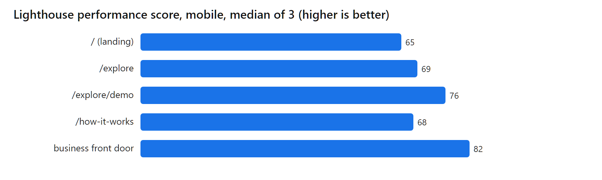
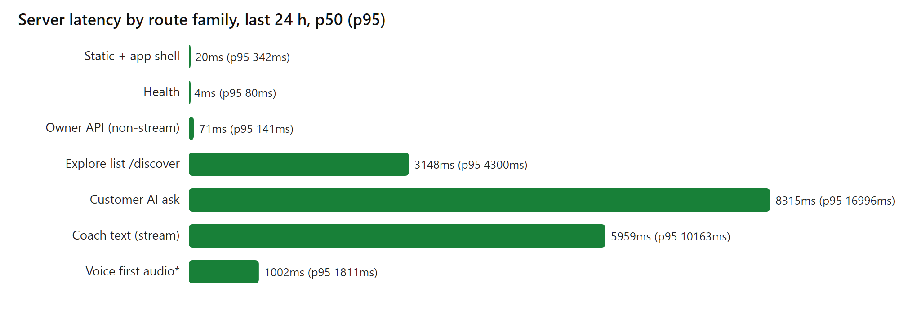
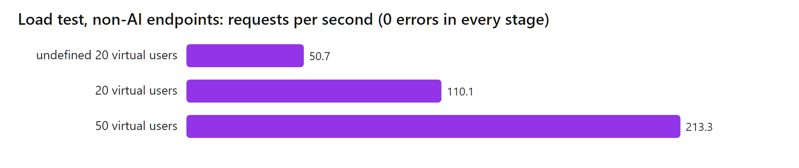

# Chalkboard performance report (18 October 2026)

Everything here was measured on 18 Oct 2026 against production (`https://chalkboard.shreyaan.work`,
Cloud Run `ogoogle-ai-00093-hfs`, asia-south1) from one Windows laptop in India. Nothing paid was
called: no Gemini, Maps, TTS, Vision or Document AI request was made by any test. Cloud Monitoring
and Cloud Logging were read only. Raw data is in [perf/](perf/).

## One-page summary

| #   | Number                                                                          | How it was measured                                                                                                                                |
| --- | ------------------------------------------------------------------------------- | -------------------------------------------------------------------------------------------------------------------------------------------------- |
| 1   | **213 requests/s, 0 errors, p95 858 ms** at 100 virtual users (9,060 requests)  | `scripts/load-cloud.mjs` against Cloud Run, non-AI endpoints only, 40 s stage; 20 → 50 → 100 users, 15,886 requests in all, **0 errors**           |
| 2   | **Cloud Run scaled 3 → 7 instances by itself** during the test (cap is 10)      | Cloud Monitoring `container/instance_count`, 1-minute max, active state                                                                            |
| 3   | **0.007% server errors**: 2 of 30,951 requests were 5xx in 24 h                 | Cloud Monitoring `request_count` by response class, `ogoogle-ai`, last 24 h                                                                        |
| 4   | **Median server time 21 ms** for ordinary pages and API calls (p95 456 ms)      | 30,637 request-log latencies in 24 h, long-lived streams removed                                                                                   |
| 5   | **Voice reply starts in 1.0 s** (p95 1.8 s)                                     | `coach_latency flow=voice_first_audio` log lines, n = 28, owner's last words → first audio sent                                                    |
| 6   | **Coach text reply starts in 4.6 s** (p95 7.9 s), instant answers 0.2 s         | `coach_latency flow=text_agent` n = 8, `text_instant` n = 1, last 24 h. Small samples                                                              |
| 7   | **Phone score 65–82 / 100 on the main pages**, CLS 0 to 0.05                    | Lighthouse 13.5, mobile, simulated slow 4G and 4x CPU, median of 3 runs per page. Home is 65, `/explore` 69, demo 76, how-it-works 68, business 82 |
| 8   | **Menu prices 30/30 right, golden dataset 41/41 structured and 22/22 contract** | [evaluation.md](../impact/evaluation.md): golden upload dataset (PR #188), live Gemini on 16 photos, run 18 Oct                                    |

Honest weak spots, also in the numbers: the explore list takes 3.1 s (median) and the front-door
AI answer 8.3 s, and the mobile Lighthouse score is in the 60s and 70s for four of five pages,
held back by script work on a throttled phone (see "Quick wins").





## 1. Web vitals on a phone (Lighthouse)

Lighthouse 13.5.0, `--preset=perf`, mobile form factor (Moto G-class emulation, simulated slow 4G,
4x CPU slowdown), headless Chrome, 3 runs per page, **median** reported. Production, 18 Oct
~09:00–09:30 UTC. Raw: [perf/lighthouse-summary.json](perf/lighthouse-summary.json).

| Page                                        | Score (3 runs) | Median score |   FCP |   LCP | TBT (INP proxy) |   CLS | JS sent (compressed / raw) | Page weight |
| ------------------------------------------- | -------------: | -----------: | ----: | ----: | --------------: | ----: | -------------------------: | ----------: |
| `/` landing                                 |   67 / 65 / 48 |       **65** | 4.9 s | 4.9 s |          252 ms | 0.047 |               205 / 594 KB |      389 KB |
| `/explore`                                  |   66 / 71 / 69 |       **69** | 3.0 s | 5.0 s |          284 ms |     0 |             605 / 1,510 KB |      675 KB |
| `/explore/demo`                             |   88 / 76 / 75 |       **76** | 3.3 s | 3.3 s |          366 ms | 0.000 |             608 / 1,890 KB |      675 KB |
| `/how-it-works`                             |   68 / 68 / 47 |       **68** | 2.9 s | 5.2 s |          294 ms |     0 |               211 / 606 KB |    1,415 KB |
| Business front door (`business.` subdomain) |   82 / 86 / 79 |       **82** | 3.5 s | 3.5 s |          123 ms | 0.000 |             306 / 1,064 KB |      372 KB |

Notes:

- INP is a field metric and cannot be measured in a lab run. Total Blocking Time (TBT) is the
  standard lab stand-in: 123–366 ms here, "needs improvement" on the throttled phone.
- CLS is in the good range (under 0.1) on all five pages.
- The 4x CPU throttle is harsh; a mid-range phone on real Wi-Fi will feel faster than these
  scores. They are comparable between pages and between runs, which is what the table is for.
- Run-to-run spread is large (landing 48–67, how-it-works 47–68). The medians are what to quote.
- Earlier **local** browser timings (production bundle, offline backend, 360×800, 10 runs each, 16 Oct,
  from `docs/impact/latency-browser.json` on branch `docs/load-latency`): customer first answer p50
  185 ms, send tap 32 ms, owner tab switch 36 ms, coach first words 212 ms. These measure the app's
  own response after load, with no network and no model, so they are not comparable to the
  Lighthouse load numbers above.

### Quick wins (not done in this PR; app code is untouched)

Found in the Lighthouse audits and the live response headers.

| #   | Win                                                                                                                                                                                                                                                                                                                       | Evidence                                                                                                                                  | Expected gain                                                                  |
| --- | ------------------------------------------------------------------------------------------------------------------------------------------------------------------------------------------------------------------------------------------------------------------------------------------------------------------------- | ----------------------------------------------------------------------------------------------------------------------------------------- | ------------------------------------------------------------------------------ |
| 1   | **Stop the `/how-it-works` hero video competing for bandwidth.** The LCP element is a phone-demo `<video>` further down the page (about 1,900 px from the top); its 3.4 s "resource load delay" plus 1.4 s load make LCP 5.2 s. Make the first screen's LCP a light, preloaded image and keep the videos `preload="none"` | LCP breakdown on `/how-it-works`: TTFB 0.2 s, load delay 3.4 s, load 1.4 s. Poster JPGs are 57–77 KB, MP4 ~1 MB                           | LCP ~5.2 s → ~3 s on that page (Lighthouse also lists 22 KiB of image savings) |
| 2   | **Cache the demo videos and posters.** `/how-it-works/*.mp4` and `*.jpg` are served with `Cache-Control: no-store`, so every visit re-downloads ~1 MB per video. Give `public/` media a long `max-age`. Fonts under `/assets/` come back as `max-age=3600` from the CDN layer while the app sets one year                 | `curl` of the live URLs; Lighthouse "cache" insight estimates 218–535 KiB re-downloaded per visit and 600–1,250 ms of LCP on repeat views | Repeat visits: up to ~0.6–1.2 s faster LCP, up to ~0.5 MB less data            |
| 3   | **Split the 360 KB entry chunk and the 518 KB `copy-*.js` language chunk.** `/explore/demo` ships 1.9 MB of script (608 KB compressed); Lighthouse says 96 KiB of it is unused on first paint (`copy-*.js` 48% unused, `RichText` 81% unused). Load each language's copy on demand instead of all locales                 | Lighthouse "unused JavaScript" on `/explore/demo`; build warns about large chunks                                                         | ~100 KB less to parse; TBT on the demo page down by an estimated 50–100 ms     |
| 4   | **Render something before the framework boots.** On `/` and `/explore` the LCP text is ready 0.2 s after the first byte but paints at ~4.9 s ("element render delay" 4.7 s): it is client-rendered. Static hero HTML in `index.html`, or server-rendered first screen, removes the wait                                   | LCP breakdown on `/` and `/explore`: TTFB 0.19–0.22 s, element render delay 4.67–4.69 s                                                   | LCP 4.9–5.0 s → roughly 2–3 s on both; biggest single score gain               |
| 5   | **Make the `index-*.css` file non-blocking.** One 10.8 KB stylesheet blocks first paint on every page (Lighthouse "render-blocking")                                                                                                                                                                                      | Render-blocking insight, same file on all pages                                                                                           | Small: tens of ms on FCP                                                       |

Gains are estimates from the Lighthouse audits, not re-measured after a change. Quick win 4 is a
larger piece of work than the others; 1, 2 and 5 are each a few lines.

## 2. Server (Cloud Monitoring and request logs, last 24 h)

Window: 17 Oct 09:31 → 18 Oct 09:31 UTC. Service `ogoogle-ai` (Cloud Run, asia-south1, 1 vCPU / 2 GiB,
concurrency 40, 1 → 10 instances) and `ogoogle-face` (face worker, 0 → 1).

| Metric                                                         | `ogoogle-ai`                                                                                                | `ogoogle-face`                  |
| -------------------------------------------------------------- | ----------------------------------------------------------------------------------------------------------- | ------------------------------- |
| Requests (Monitoring)                                          | 30,951: 29,032 2xx, 1,893 4xx, 24 1xx (websocket upgrades), **2 5xx**                                       | 3 (all 2xx)                     |
| 5xx rate                                                       | **0.0065%**                                                                                                 | 0%                              |
| 4xx                                                            | 6.1% (401/403/404; not broken down further)                                                                 | 0                               |
| Latency, all requests incl. streams                            | p50 / p95 / p99 not meaningful: long-lived SSE and WebSocket requests (up to 1 h) dominate the distribution | p50 1.2 s, p95 1.5 s, p99 1.6 s |
| Latency, ordinary requests (logs, streams removed, n = 30,637) | **p50 21 ms, p95 456 ms, p99 3.2 s**                                                                        | —                               |
| Instances                                                      | hourly peak between 1 and 11 (can exceed the cap of 10 briefly while a new revision rolls out); 1 always on | 1 when used                     |
| Container starts (cold starts)                                 | 68 in 24 h; startup p50 ≈ 15.9 s, p95 ≈ 17.2 s                                                              | 2; startup ≈ 7.9 s              |
| CPU / memory (p95 of utilisation, max across instances)        | 36% / 16%                                                                                                   | 23% / 16%                       |

The two 5xx were `POST /businesses/{id}/day/read` (photo day-close): a 503 after 14.9 s and a 504
after 60.6 s, from the same shop; the log shows `day_read_failed` once. Every other route had zero.

The 68 container starts are mostly deploys and scale-out; with a 16 s startup, a request that lands
on a brand-new instance waits for it. `min instances = 1` keeps the first user from paying that.

### By route family (request logs, same window)

| Family                                 | Requests |       p50 |        p95 | 5xx | Note                                                |
| -------------------------------------- | -------: | --------: | ---------: | --: | --------------------------------------------------- |
| Static files and app shell             |   19,995 |     20 ms |     342 ms |   0 | HTML, JS, images, icons                             |
| Health                                 |    5,081 |      4 ms |      80 ms |   0 | includes uptime checks                              |
| Other API (bootstrap, trust, demo, …)  |    2,529 |     31 ms |     535 ms |   0 |                                                     |
| Owner API (non-stream)                 |   ~2,000 |     71 ms |     141 ms |   2 | today, orders, inquiries, mappings                  |
| Explore list (`/discover`, `/suggest`) |      925 | **2.5 s** |  **4.0 s** |   0 | Firestore read of all shared shops + Google Places  |
| Place photos                           |      220 |    564 ms |      2.7 s |   0 | proxy to Google Places photos                       |
| Customer AI ask (`POST /discover/ask`) |       40 | **8.3 s** | **17.0 s** |   0 | n = 40; full request, see section 3                 |
| Coach text (`POST /coach/stream`)      |       14 |     6.0 s |     10.2 s |   0 | n = 14; full stream, not first token                |
| Voice (`/voice` WebSocket)             |       34 |         — |          — |   0 | session length, not latency; 10 were 403 (rejected) |
| Uploads / photo-to-menu                |        2 |     4.3 s |          — |   0 | n = 2 in the window                                 |

Long-lived streams (owner inquiry stream, voice, customer thread stream) are excluded from the
24-hour "ordinary" numbers; their request time is the length of the connection, up to the
1-hour Cloud Run limit.

## 3. AI latency (Cloud Logging, last 24 h)

The app logs `coach_latency` for each coach turn (see [latency.md](../impact/latency.md)); the other
AI routes are timed from the request log. 24 h of production traffic is small, so some samples are
thin; the table says so.

| Flow                               |   n |    p50 |    p95 | What it measures                                                                                     |
| ---------------------------------- | --: | -----: | -----: | ---------------------------------------------------------------------------------------------------- |
| Coach, **instant path** (no model) |   1 | 0.22 s |      — | message → answer. One sample in 24 h; offline bench (160 turns) is 15 ms p50 / 34 ms p95 server-side |
| Coach, **first token from Gemini** |   8 |  4.6 s |  7.9 s | message → first streamed output (`text_agent`)                                                       |
| Voice, **first audio**             |  28 |  1.0 s |  1.8 s | owner's last words → first reply audio sent (`voice_first_audio`)                                    |
| Customer **answer**, whole request |  40 |  8.3 s | 17.0 s | `POST /discover/ask` start → stream end (Gemini plus Google Places)                                  |
| **Photo → menu** (`POST /import`)  |   1 |  4.3 s |      — | one real menu photo in the window                                                                    |

How to read this:

- **Customer answer time, local vs Gemini:** the request log has only the total, so the split
  between a local match and a Gemini answer is not in production logs. The browser benchmark of
  16 Oct measured the part the customer sees first: shops from the app's own list appear as
  `event: instant` over the stream in under 10 ms server-side, and in the browser the first
  answer cards appeared at **132 ms p50 / 308 ms p95** (5 runs, Pixel-7 viewport, offline
  backend; [customer-latency.md](../impact/customer-latency.md)). The 8.3 s above is the whole
  AI answer finishing, which is when the words stop streaming.
- **Coach:** the same 16 Oct work measured offline instant-path latency (above). Before it, full
  Gemini turns took p50 4.7 s and p95 8.8 s over 26 scenarios (`coach-eval-gemini-3.5-flash.json`).
  Production's `text_agent` first-token p50 of 4.6 s agrees with that, from only 8 live turns.
- **Voice first audio** is the best AI number: 28 sessions, 1.0 s median, 1.8 s p95. Production runs
  Cloud Run in Mumbai and Gemini Live in us-central1, so part of that second is probably the cross-region hop (not separated out)
  ([latency.md](../impact/latency.md#gemini-live-region-voice)).
- **Photo → menu:** only one live sample in this window. The golden live run (16 menu photos, Gemini
  3.5 Flash + 4 Document AI receipts, 175 s for 20 provider calls) is the larger sample: about 8.7 s
  per call on average.

## 4. Light load test (non-AI endpoints only)

Script [scripts/load-cloud.mjs](../../scripts/load-cloud.mjs), run **straight against Cloud Run**
(`ogoogle-ai-5dnlvslisq-el.a.run.app`) because the public domain sits behind Cloud Armor, which
allows 300 requests per minute per IP and answers 429 above that (measured on 18 Oct: 10,902 of
11,378 requests rejected; [scalability.md](../impact/scalability.md)). One laptop can't measure
capacity through the domain, but it shows the rate limit works.

Endpoints in the loop, with 100 ms think time: `/api/v1/health`, the customer shop page
(`/explore/s/<demo shop>` HTML) and the hashed app bundle (static JS), plus one extra user calling
the explore list every 2.5 s. **No public shop JSON** (`/public/shops/{id}`) was called: it
increments the shop's page-view count, which would corrupt a demo shop's numbers. No AI route was
called. 18 Oct, 09:36–09:38 UTC. Raw: [perf/load-20-vus.json](perf/load-20-vus.json),
[perf/load-50-vus.json](perf/load-50-vus.json), [perf/load-100-vus.json](perf/load-100-vus.json).

| Stage (40 s each) | Requests | Errors |   RPS | p50 ms | p95 ms | p99 ms | Max ms |
| ----------------- | -------: | -----: | ----: | -----: | -----: | -----: | -----: |
| 20 users          |    2,193 |      0 |  50.7 |    166 |    471 |  4,081 |  6,378 |
| 50 users          |    4,633 |      0 | 110.1 |    181 |    637 |  3,798 | 18,348 |
| **100 users**     |    9,060 |      0 | 213.3 |    243 |    858 |  1,457 |  6,804 |

Per endpoint at 100 users: health p50 181 ms / p95 380 ms, shop page 208 / 505 ms, app bundle
479 / 1,125 ms, explore list 4.5 s / 6.3 s (the only slow call, see below).

- **Errors:** 0 of 15,886 requests. The stop rule (errors above 1%) never came close.
- **Instances:** 3 before the test, **7 by 09:38**, against a cap of 10. The run never reached the
  cap. (The test used three consecutive 40-second stages, 2 minutes in total, rather than a
  ramp, so each stage is a separate row.)
- **Compared with the 18 Oct morning test** (50 users, 60 s: 155 req/s, p50 154 ms, p95 573 ms,
  2 → 4 instances): 50 users now gives 110 req/s at p95 637 ms, within run-to-run noise; the
  double load (100 users) holds at 213 req/s with p95 858 ms.
- **Compared with the 16 Oct laptop-local baseline** (one local process, SQLite, health only,
  `docs/impact/load-baseline.json`): 383 req/s at 10 users with p95 50 ms, but 58 req/s at 100
  users (single worker, the load generator on the same machine). Production is slower per request
  because of the network (India → Mumbai), but it scales out: the local one cannot.
- **Explore list is the slow path:** 3 to 4.5 s median under load, as in the earlier test. It reads
  every shared shop from Firestore and calls Google Places. This is the first server-side thing to
  fix before there are thousands of shops (cache the list per region for a minute).

## 5. Accuracy numbers (already measured)

Cited, not re-run. Sources are in `docs/impact/`.

| Measure                                   | Result                                                                                       | Source                                                                               |
| ----------------------------------------- | -------------------------------------------------------------------------------------------- | ------------------------------------------------------------------------------------ |
| Golden upload dataset, structured imports | **41 / 41**, field precision/recall 1.000                                                    | [evaluation.md](../impact/evaluation.md), PR #188                                    |
| Golden dataset, model-contract cases      | **22 / 22** (maps recorded replies correctly; not OCR accuracy)                              | same                                                                                 |
| Live menu photos (Gemini 3.5 Flash)       | 15 / 16 read; **30 / 30 prices**, 15 / 15 item counts, 9 / 15 fully exact (misses are names) | same, 18 Oct                                                                         |
| Live receipts (Document AI)               | Totals 4 / 4                                                                                 | same                                                                                 |
| Semantic search precision@5               | **0.728 → 0.902**                                                                            | [SCORECARD.md](SCORECARD.md), PR #216                                                |
| Business kind detection                   | 39 / 40, 0 irrelevant questions of 215                                                       | SCORECARD.md                                                                         |
| Impact measurements (offline, PR #49)     | Voice-fixture shop save 1.54 s, manual form 1.85 s, photo day-close 0.64 s (medians)         | [measurements.md](../impact/measurements.md); synthetic inputs, not owner time saved |

## What this report does not show

- No field data (real-user INP, CrUX): the product has too little traffic for it. The Lighthouse
  numbers are lab numbers on a throttled profile.
- The load test did not touch AI routes, the public shop JSON, uploads or WebSockets, so it says
  nothing about Vertex quota, which is what limits those (at most 8 concurrent coach runs by design).
- It did not look for a breaking point; it stopped at 100 users and 7 of 10 instances.
- 24 h of traffic includes some other people's tests and bot scans (about 6% 4xx), and my own 15
  Lighthouse loads and the load test fall inside the last hour of the window, so the static
  numbers are slightly flattered by warm caches.
- The three AI log samples (coach 8, instant 1, upload 1) are too small for percentiles to mean
  more than "same order as the earlier controlled runs".

## How to repeat

```powershell
# Lighthouse (one page; repeat 3 times and take the median)
npx lighthouse https://chalkboard.shreyaan.work/ --preset=perf --form-factor=mobile --output=json
# Load test, straight to Cloud Run
node scripts/load-cloud.mjs --origin https://ogoogle-ai-5dnlvslisq-el.a.run.app --vus 100 --seconds 40 --out perf-100.json
# Request logs for the last 24 h
gcloud logging read 'resource.type="cloud_run_revision" AND resource.labels.service_name="ogoogle-ai" AND logName="projects/ichiropractic/logs/run.googleapis.com%2Frequests"' --freshness=24h --limit=40000
```
