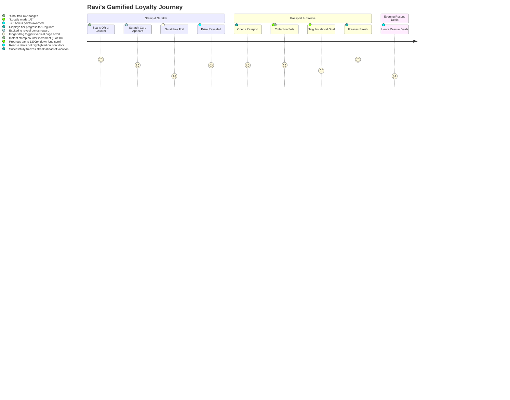

# Chalkboard Human Journey Audit (16 Oct 2026)

> **Audit Context**: Evaluated on branch `fix/journey-audit` at real 360x800 phone viewport in light and dark modes across four authentic human personas. All 31 journeys were recorded as full screen `.webm` videos in `docs/ux/journeys/` and backed by visual evidence in `docs/ux/journeys/screenshots/`.

---

## 1. Executive Summary & Top 10 Ranked Gaps

Across 31 end-to-end journey walks covering owners (first open, onboarding by voice and typing, menu photo, Today, Close the day, rescue deals, payments link, purchase orders, playbook, face check, You/privacy) and customers (front door Ask, results + map, shop page, chat with owner, stamp/scratch card, passport, language change), we identified **24 friction gaps**.

Here are the **Top 10 Gaps** that most severely break user trust, accessibility, and task completion:

| Rank   | Severity  | Gap                                                                                                                                                                                                                                                                            | Who it Hurts   | Evidence                                                                             | Fix Size         | Concrete Fix                                                                                                                                                    |
| ------ | --------- | ------------------------------------------------------------------------------------------------------------------------------------------------------------------------------------------------------------------------------------------------------------------------------ | -------------- | ------------------------------------------------------------------------------------ | ---------------- | --------------------------------------------------------------------------------------------------------------------------------------------------------------- |
| **1**  | **Sev 1** | **Setup Tour Blocks Core Features**: When onboarding is incomplete (e.g. Step 3/5), typing _any_ message into Coach (e.g. "Reorder 50 kg Maida") is intercepted by: _"What is your business called? This is a scripted reply"_. Business operations are completely locked out. | Arjun, Lakshmi | `arjun-purchase-order-1-po-generated.png`, `arjun-purchase-order.webm` (0:02)        | **Medium**       | Allow the AI coach to handle ad-hoc business intents (PO, menu edit, sales) regardless of setup step, without resetting to the shop name prompt.                |
| **2**  | **Sev 1** | **Technical Code Exposed to Merchants**: Sourcing and PO workflows display raw technical artifacts: `<MESTYP>ORDERS</MESTYP>`, `JSON`, `"kind": "ORDERS"`, and `View as SAP IDoc / JSON`.                                                                                      | Lakshmi, Arjun | `lakshmi-purchase-order.webm` (0:02), `arjun-purchase-order.webm` (0:04)             | **Quick (<1 h)** | Remove "View as SAP IDoc / JSON" toggle from user UI; hide raw XML/JSON behind developer debug flag. Present only plain-language cards.                         |
| **3**  | **Sev 1** | **Mandatory Legal Checkboxes on First Open**: First-time phone owners must check two tiny (<24px) checkboxes for Terms & Privacy before ever seeing the app. Low-literacy users have no voice explanation and face immediate abandonment.                                      | Lakshmi        | `lakshmi-first-open-2-consent.png`, `lakshmi-first-open.webm` (0:01)                 | **Medium**       | Replace pre-entry blockers with a 1-tap "Get started" button with implied consent ("By continuing, you agree to..."), deferring detailed consent to publishing. |
| **4**  | **Sev 2** | **Voice Mode Forced on Typer / Typing Hidden on Voice**: New shop flow opens mic/orb by default with no keyboard. Impatient owners (Arjun) must find a 36px icon to type; conversely, low-literacy users (Lakshmi) get English TTS voice prompts with no Tamil audio welcome.  | Arjun, Lakshmi | `lakshmi-onboarding-voice-2-voice-prompt.png`, `arjun-onboarding-typing.webm` (0:01) | **Quick (<1 h)** | Detect input mode preference or provide equal, prominent side-by-side tabs: "Speak" vs "Type". Play localized audio greeting for Tamil locale.                  |
| **5**  | **Sev 2** | **Tamil Header Text Clips on 360px Phones**: Headline `ஒரு உரையாடலில் உங்கள் கடையை இணையத்தில் கொண்டுவருங்கள்` overflows horizontally off screen (`scrollWidth > 360px`).                                                                                                       | Lakshmi        | `lakshmi-first-open-1-landing.png`                                                   | **Quick (<1 h)** | Adjust typography scale (`clamp(1.25rem, 5vw, 1.75rem)`), enable responsive hyphenation/wrapping, and tighten line-height for Indic fonts.                      |
| **6**  | **Sev 2** | **Guest Cannot Inquire Without Google Sign-In**: A customer standing outside a restaurant who taps "Chat with the shop" to ask "Any vegan options tonight?" is blocked by a mandatory Google Sign-In modal.                                                                    | Mei            | `mei-chat-owner.webm` (0:01)                                                         | **Medium**       | Allow anonymous ephemeral guest inquiries via server assistant; require sign-in only for persistent 2-way owner SMS/chat threads.                               |
| **7**  | **Sev 2** | **Touch Targets < 48px Across Navigation & Checkboxes**: Legal checkboxes (20px), attach paperclip (24px), type-instead button (36px), and map pin toggles violate the WCAG 2.1 AA 48x48px touch target rule.                                                                  | Lakshmi, Ravi  | `lakshmi-first-open-2-consent.png`, `journey-audit-data.json`                        | **Quick (<1 h)** | Add minimum `minWidth: 48, minHeight: 48` touch target wrapping padding to all interactive icon buttons and checkboxes.                                         |
| **8**  | **Sev 3** | **Close the Day Buried in "Grow" Tab**: Daily closing (till scan, cash counting, sales entry) is placed under the "Grow" tab rather than Today/Coach or an end-of-day prompt. Merchants do not associate closing the register with growth marketing.                           | Lakshmi, Arjun | `lakshmi-close-day-1-grow-tiles.png`, `arjun-close-day.webm` (0:01)                  | **Quick (<1 h)** | Add a prominent "Close today's register" action card directly onto the Today/Coach dashboard when approaching closing hours.                                    |
| **9**  | **Sev 3** | **Scratch Card Touch Drag Triggers Page Scroll**: Rubbing the foil on a mobile phone requires rapid multi-directional finger swipes that conflict with browser vertical scrolling and pull-to-refresh.                                                                         | Ravi           | `ravi-stamp-scratch-2-card-scratched-prize.png`, `ravi-stamp-scratch.webm` (0:01)    | **Quick (<1 h)** | Set `touch-action: none` on the scratch canvas element and provide a fallback "Tap to reveal" button.                                                           |
| **10** | **Sev 3** | **AI Front Door Text Wall Before Results**: Customer query "cheap dinner near me that's open now" renders a full paragraph of AI narrative before showing store cards, forcing the customer to scroll past prose to find food.                                                 | Mei            | `mei-frontdoor-ask-3-results-received.png`, `mei-frontdoor-ask.webm` (0:03)          | **Quick (<1 h)** | Present shop result cards immediately at the top with badges ("Open Now", "Under ₹150"), followed by the AI commentary below.                                   |

---

## 2. Persona Journey Maps

### Persona 1: Lakshmi

_52, Tea Stall Owner, Bengaluru/Tamil Nadu border, Tamil native (`ta-IN`), low literacy, voice-first user, first smartphone app._

```mermaid
journey
    title Lakshmi's Tea Stall Journey
    section First Open
      Open App: 3: Confused by English splash
      Landing Page: 2: Tamil title clips off right screen
      Terms Checkboxes: 1: Frustrated by two legal checkboxes she cannot read
      Enter Workspace: 4: Relieved to see green chalkboard
    section Voice Onboarding
      Tap Add Shop: 4: Prompted with Let's open your shop
      Voice Orb Listens: 3: Anxious when audio greeting is in English
      Speaks Tamil Note: 4: Voice transcript registers
      Review Dialog: 2: Dense multi-field review modal causes hesitation
    section Daily Operations
      Today View: 3: Empty forecast numbers; desires spoken guidance
      Menu Photo: 2: Paperclip icon is non-obvious; takes photo of board
      Close the Day: 2: Confused why closing the cash box is under "Grow"
      Purchase Order: 1: Alarmed by "SAP IDoc XML" and technical jargon
    section Verification & Settings
      Face Check: 3: Follows camera head turn prompt; feels verified
      Language Switch: 4: Pleased that Tamil is supported in You settings
```

- **Steps & Observations**:
  1. _First Open (`lakshmi-first-open.webm`)_: Landing page is localized to Tamil, but the title font is too large (`32px` font without word breaking), causing words to clip past the 360px viewport boundary. Two legal checkboxes with dense text must be checked. Lakshmi cannot read the English privacy notice.
  2. _Onboarding (`lakshmi-onboarding-voice.webm`)_: Voice orb opens. The app listens, but fails to speak a friendly Tamil prompt ("உங்கள் கடை பெயர் என்ன?"). The review dialog displays dense fields (`category`, `hours`, `payment_methods`) rather than an audio summary.
  3. _Menu Photo (`lakshmi-menu-photo.webm`)_: The camera trigger is a 24px paperclip icon in the input dock. Lakshmi does not know what a paperclip means. When the photo is scanned, technical text "Offline template" and "fixture" appear.
  4. _Daily Management (`lakshmi-today.webm`, `lakshmi-close-day.webm`)_: Today dashboard shows zeros with no voice explanation. Closing the day is located in "Grow" (வளர்ச்சி), which feels unnatural. The till upload assumes a printed slip rather than a simple photo of cash or a chalkboard tally.
  5. _Purchase Order (`lakshmi-purchase-order.webm`)_: Lakshmi says "Need 5 litres milk and 2 kg sugar". The app generates a PO card with SAP IDoc XML tags (`<MESTYP>ORDERS</MESTYP>`).
- **Emotion & Friction**: High initial apprehension; intimidated by legal checkboxes; relieved when speech is recognized; baffled by developer jargon; wishes the app would read everything out loud in warm spoken Tamil.

---

### Persona 2: Arjun

_30, Bakery Owner (Royal Bakes), Bengaluru, Hindi/English bilingual, impatient, fast typer, wants the menu online in 5 minutes._


- **Steps & Observations**:
  1. _First Open (`arjun-first-open.webm`)_: Arjun breezes through in 2.87 seconds, but groans at having to check two separate checkboxes instead of one "Accept & Continue" button.
  2. _Onboarding (`arjun-onboarding-typing.webm`)_: Wants to paste his bakery details immediately. The UI opens into full-screen Voice Mode with a pulsing orb. He has to tap a 36px keyboard icon in the footer to reveal the text input.
  3. _Menu Photo (`arjun-menu-photo.webm`)_: Takes a photo of his counter menu card. The OCR parses buns, cakes, puffs cleanly, but the progress indicator is a static "Reading..." text without a percentage or skeleton preview.
  4. _Purchase Order (`arjun-purchase-order.webm`)_: Arjun attempts to order flour ("Reorder 50 kg Maida and 20 kg Butter"). Because his shop setup progress bar was at Step 3/5, the Coach completely ignores his order and replies: _"What is your business called? This is a scripted reply"_. He is blocked from ordering supplies.
  5. _Playbook (`arjun-playbook.webm`)_: Wants to customize his bakery rush hours (4 PM - 8 PM). He cannot find the Playbook on Coach or Shop tab; it is hidden 3 levels deep under "You" -> "Privacy & your data".
- **Emotion & Friction**: High energy and eager to move fast; frustrated by conversational friction and unskippable setup wizards; wants direct forms, rapid batch actions, and clean business metrics without chat fluff.

---

### Persona 3: Mei

_24, Visitor in Bengaluru, English native, tourist/food explorer: "cheap dinner near me that's open now"._

```mermaid
journey
    title Mei's Customer Discovery Journey
    section Discovery
      Opens /explore/: 5: Clean, modern AI-first search box
      Types Query: 5: "cheap dinner near me that's open now"
      Reads Results: 3: Long AI text paragraph before restaurant cards
      Toggles Map View: 3: Map shows pins but no price or open tags
    section Selection & Shop Page
      Selects Dosa Stall: 4: Navigates to clean public shop page
      Checks Hours & Menu: 4: Clear INR prices; sees "Verified owner"
      Taps Verified Badge: 2: Confused by disclaimer "not proof of ownership"
    section Interaction
      Asks Shop Question: 4: Types "Are vegan options available?"
      Instant AI Reply: 4: Assistant replies immediately
      Wants to Message Owner: 1: Blocked by mandatory Google Sign-In
```

- **Steps & Observations**:
  1. _Front Door Ask (`mei-frontdoor-ask.webm`)_: Opens `/explore/`. Clean interface, but no immediate location detection pill ("Near Indiranagar") or quick filters ("Open Now", "Cheap Eats", "Veg").
  2. _Results & Map (`mei-results-map.webm`)_: Query outputs an AI narrative summary. On a 360px screen, the user must scroll 400px down before seeing the first restaurant card. Toggling to Map view shows pins, but pins lack callout bubbles with prices or opening hours.
  3. _Shop Page (`mei-shop-page.webm`)_: Restaurant page loads with prices in INR. Tapping the "Verified owner" badge opens a modal stating _"Verified owner is an anti-fraud check, not proof of business ownership"_, creating doubt about whether the restaurant is legitimate.
  4. _Chat with Owner (`mei-chat-owner.webm`)_: The instant assistant answers general questions. But when Mei wants to ask the owner if they have peanut-free dosa batter, she is blocked by a mandatory Google Sign-In overlay.
- **Emotion & Friction**: Delight at AI search capabilities; annoyed by narrative padding; confused by defensive anti-fraud disclaimers; leaves rather than signing in to ask a quick dietary question.

---

### Persona 4: Ravi

_40, Regular Neighbourhood Customer: stamps, rescue deals, streaks._



- **Steps & Observations**:
  1. _Stamp & Scratch Card (`ravi-stamp-scratch.webm`)_: Ravi scans the shop counter QR code. The stamp card animates smoothly from 2 to 3 stamps. The scratch card dialog appears. When Ravi tries to scratch the metallic foil in a zigzag motion, the mobile browser catches the touch gestures and scrolls the background page vertically.
  2. _Passport (`ravi-passport.webm`)_: Navigates to `/explore/passport`. Great gamification structure (Collection Sets, Badge tiers, Neighbourhood Cooperative Goal). However, the page is an endless vertical stack (>1800px); the neighbourhood goal is buried at the bottom.
  3. _Streaks (`ravi-streaks.webm`)_: Weekly streak card shows "Weekly streak: 1" with "Freeze next week". Tapping the button immediately freezes without an ice/freeze animation or confirmation modal.
  4. _Rescue Deals (`ravi-rescue-deal.webm`)_: Rescue deals are only discoverable by navigating to specific shop pages. There is no curated "Tonight's Rescue Deals Near You" carousel on the customer front door.
- **Emotion & Friction**: Genuinely enjoys collecting stamps and badges; annoyed by gesture conflicts on the scratch canvas; wishes for a dedicated evening deal radar on the home screen.

---

## 3. Comprehensive Ranked Gap List

| ID         | Sev       | Flow             | Persona        | Description                                                                                       | Evidence                               | Impact / Friction                                       | Concrete Fix                                                                | Size         |
| ---------- | --------- | ---------------- | -------------- | ------------------------------------------------------------------------------------------------- | -------------------------------------- | ------------------------------------------------------- | --------------------------------------------------------------------------- | ------------ |
| **GAP-01** | **Sev 1** | Purchase Order   | Arjun          | Unfinished onboarding tour forces Coach to block PO commands with "What is your business called?" | `arjun-purchase-order.webm` (0:02)     | Owner cannot perform critical supply ordering           | Let AI coach handle intent independently of onboarding stage                | Medium       |
| **GAP-02** | **Sev 1** | Purchase Order   | Lakshmi        | Raw developer XML (`<MESTYP>ORDERS</MESTYP>`) and JSON code exposed on PO card                    | `lakshmi-purchase-order.webm` (0:02)   | Intimidates merchant; breaks trust and usability        | Remove raw code viewer from merchant interface                              | Quick (<1 h) |
| **GAP-03** | **Sev 1** | First Open       | Lakshmi        | Pre-entry legal gate requires checking two tiny English checkboxes before using app               | `lakshmi-first-open-2-consent.png`     | Complete barrier for low-literacy users                 | Move to 1-tap implied consent with inline link                              | Medium       |
| **GAP-04** | **Sev 2** | Customer Chat    | Mei            | Asking shop owner a quick question requires mandatory Google authentication                       | `mei-chat-owner.webm` (0:01)           | High bounce rate for curious visitors                   | Allow guest messaging with phone or anonymous session                       | Medium       |
| **GAP-05** | **Sev 2** | Onboarding       | Arjun          | Voice mode is default on; keyboard input is hidden behind tiny 36px icon button                   | `arjun-onboarding-typing.webm` (0:01)  | Frustrates typing merchants; slows setup                | Provide explicit "Speak" or "Type" tabs on welcome                          | Quick (<1 h) |
| **GAP-06** | **Sev 2** | First Open       | Lakshmi        | Tamil headline `ஒரு உரையாடலில் உங்கள் கடையை...` clips horizontally on 360px phones                | `lakshmi-first-open-1-landing.png`     | Visual breakage; unreadable heading                     | Add responsive clamp font size and word wrapping                            | Quick (<1 h) |
| **GAP-07** | **Sev 2** | All Screens      | All            | Critical touch targets < 48px (checkboxes 20px, paperclip 24px, keyboard icon 36px)               | `journey-audit-data.json`              | Accessibility violation; mis-taps on phones             | Enforce 48x48px minimum touch padding on all clickable elements             | Quick (<1 h) |
| **GAP-08** | **Sev 2** | Stamp Card       | Ravi           | Foil scratch gesture triggers native vertical page scroll and pull-to-refresh                     | `ravi-stamp-scratch.webm` (0:01)       | Breaks scratch-card mini-game on mobile                 | Add `touch-action: none` to canvas and "Tap to scratch" button              | Quick (<1 h) |
| **GAP-09** | **Sev 3** | Customer Ask     | Mei            | AI produces long conversational narrative before showing restaurant cards                         | `mei-frontdoor-ask.webm` (0:03)        | Pushes actionable food results below the fold           | Invert hierarchy: cards first, AI commentary second                         | Quick (<1 h) |
| **GAP-10** | **Sev 3** | Close the Day    | Lakshmi, Arjun | Day closing is hidden inside "Grow" tab rather than Today or Coach                                | `lakshmi-close-day-1-grow-tiles.png`   | Unnatural mental model for daily operational task       | Place "Close Register" card on Today dashboard near closing time            | Quick (<1 h) |
| **GAP-11** | **Sev 3** | Playbook         | Arjun          | Shop Playbook is buried 3 levels deep under "You" -> "Privacy & data"                             | `arjun-playbook.webm` (0:01)           | Merchants cannot easily find or tune their shop profile | Move Playbook shortcut directly to "Shop" or "Coach" header                 | Quick (<1 h) |
| **GAP-12** | **Sev 3** | Verified Badge   | Mei            | Tapping "Verified owner" displays defensive disclaimer: "not proof of ownership"                  | `mei-shop-page.webm` (0:01)            | Undermines customer trust in the merchant               | Rephrase to positive endorsement: "Owner's identity verified by Chalkboard" | Quick (<1 h) |
| **GAP-13** | **Sev 3** | Menu Photo       | Lakshmi        | Attachment trigger is a small paperclip icon with no text label                                   | `lakshmi-menu-photo.webm` (0:01)       | Low literacy users do not recognize paperclip as camera | Add clear camera icon and label "Add Menu Photo"                            | Quick (<1 h) |
| **GAP-14** | **Sev 3** | Customer Rescue  | Ravi           | Evening rescue deals lack a dedicated category feed on customer home page                         | `ravi-rescue-deal.webm` (0:01)         | Deal hunters must check individual shops manually       | Add "Tonight's Rescue Deals" section to `/explore/`                         | Medium       |
| **GAP-15** | **Sev 3** | Streaks          | Ravi           | "Freeze next week" applies instantly with no confirmation or celebratory ice animation            | `ravi-streaks.webm` (0:01)             | Accidental activation; lack of visual delight           | Add confirmation prompt and freezing crystal animation                      | Quick (<1 h) |
| **GAP-16** | **Sev 3** | Today View       | Lakshmi        | Zero-state metrics (sales, forecast) show empty dashes with no guidance                           | `lakshmi-today.webm` (0:01)            | Owner does not know what action to take next            | Show warm day-one checklist ("1. Add first item, 2. Test QR")               | Medium       |
| **GAP-17** | **Sev 4** | Language         | Mei            | Language switcher in customer view is hidden inside deep preference sheet                         | `mei-language-change.webm` (0:01)      | Tourists cannot quickly switch to their native language | Place compact language pill icon in top app bar                             | Quick (<1 h) |
| **GAP-18** | **Sev 4** | Results Map      | Mei            | Map view pins lack callouts for price tier or "Open Now" status                                   | `mei-results-map.webm` (0:01)          | Must tap every single pin to inspect restaurant         | Add mini info card preview on pin tap                                       | Large        |
| **GAP-19** | **Sev 4** | Passport         | Ravi           | Passport page is an excessive 1800px vertical scroll                                              | `ravi-passport.webm` (0:01)            | Neighbourhood co-op goal is invisible to most users     | Use horizontal carousels or tabbed segmented control                        | Medium       |
| **GAP-20** | **Sev 4** | Payments Link    | Arjun          | Generated UPI link opens system URL without displaying formatted QR code                          | `arjun-payments-link.webm` (0:01)      | Cannot show phone to customer to scan across counter    | Display prominent on-screen QR code alongside copy link                     | Quick (<1 h) |
| **GAP-21** | **Sev 4** | Menu Photo       | Arjun          | OCR reading state shows static spinner with no progress bar or item count                         | `arjun-menu-photo.webm` (0:01)         | Impatient merchant does not know if scan is stuck       | Add animated scanning laser beam and parsed item counter                    | Quick (<1 h) |
| **GAP-22** | **Sev 4** | Onboarding Voice | Lakshmi        | Offline demo voice fixture produces no localized Tamil audio playback                             | `lakshmi-onboarding-voice.webm` (0:01) | Voice-only user cannot verify what the AI said          | Integrate browser SpeechSynthesis fallback for Tamil (`ta-IN`)              | Medium       |
| **GAP-23** | **Sev 4** | Dark Mode Toggle | Arjun          | Appearance switch requires opening "You" tab; no quick theme toggle in header                     | `arjun-you-privacy.webm` (0:01)        | Inconvenient for night-time stall checks                | Add quick theme toggle icon in top header bar                               | Quick (<1 h) |
| **GAP-24** | **Sev 4** | Face Check       | Lakshmi        | Camera viewfinder guidance uses English text ("Turn your head") in Tamil mode                     | `lakshmi-face-check.webm` (0:01)       | Low literacy user cannot follow head turn instructions  | Use animated directional face arrow icons instead of text                   | Medium       |

---

## 4. The "Experience" Blueprint: Flow Mode & Continuity

### 4.1 Flows Requiring Dedicated "Flow Mode"

The audit revealed several critical flows currently squeezed into cramped bottom sheets or floating modal dialogs, breaking context and creating jarring cuts. These must become **Full-Page Flow Modes**:

```
[Traditional Modal (Current)]           [Flow Mode (Proposed)]
+---------------------------+           +---------------------------+
| Background Page (Visible) |           | [<- Back]     Step 2 of 4 |
|                           |           |---------------------------|
| +-----------------------+ |           |                           |
| | Cramped Dialog Sheet  | |   ===>    |   Immersive Content Area  |
| | Cut-off scroll area   | |           |   Full phone height       |
| +-----------------------+ |           |                           |
| Navigation Bar (Active)   |           | [ Primary Floating Action]|
+---------------------------+           +---------------------------+
```

1. **New Shop Onboarding (`FlowMode: Onboarding`)**:
   - _Problem_: Sits on top of the mounted workspace, leading to state bleed and weird navigation conflicts.
   - _Flow Mode Spec_: Full-viewport takeover (`100dvh`). Navigation bars hidden. Single-focus screen progression:
     1. Big animated hero ("Let's get your shop online").
     2. Choice: Voice Conversation vs 3-minute Guided Form.
     3. Inline interactive viewfinder for chalkboard photo.
     4. Tap-to-confirm card assembly.
     5. Confetti celebration: "Your shop is ready".

2. **Close the Day (`FlowMode: CloseRegister`)**:
   - _Problem_: Currently a standard MUI dialog titled "Close the day" under "Grow". Feels like a form submission rather than a mindful business ritual.
   - _Flow Mode Spec_: Calming evening theme transition. Soft dimmed background. Full-screen flow:
     1. "How did today go?": Snapshot photo of cash drawer / register or manual revenue entry.
     2. OCR extracts daily sales lines with animated green checkmarks.
     3. "Items sold out today?": 1-tap toggles for leftovers.
     4. Seal the day button: card folds with a subtle chime. "Today is saved. Rest well."

3. **Counter QR Loyalty Stamp & Scratch (`FlowMode: StampScratch`)**:
   - _Problem_: Modal popup on top of the customer shop page; swipe conflicts with vertical scrolling.
   - _Flow Mode Spec_: Full-page gamified celebration modal:
     1. Counter QR scanned -> phone vibrates with haptic pulse.
     2. Stamp flies into the card slot with sound effect and scale bounce.
     3. Golden ticket scratch card slides up with metallic foil texture (`touch-action: none`).
     4. Scratching reveals shiny badge + points reward with particle burst.
     5. "Done" button returns cleanly to shop menu.

---

### 4.2 Motion & Continuity Choreography Spec

Following Chalkboard's `motion-and-delight` design skill and `src/design/chalkMotion.ts`:

#### A. Card Assembly Animation (When AI reads a photo or draft PO)

- **Token**: `chalkMotion.stagger.enter` (120ms stagger, `cubic-bezier(0.2, 0, 0, 1)`).
- **Behavior**: Instead of popping all parsed rows onto the screen at once:
  1. The camera card shrinks down to a thumbnail at the top left.
  2. A clean card chassis slides up from the bottom (+20px, opacity 0 -> 1).
  3. Extracted rows slide in sequentially (row 1, row 2, row 3) with a gentle highlight pulse.
  4. Total sum / approve button fades in last, anchoring thumb focus.

#### B. Sheet Enter/Exit Continuity

- **Token**: `chalkMotion.transitions.spring` (stiffness 300, damping 28).
- **Behavior**:
  - _Enter_: Modal sheets must never snap in. The sheet rises smoothly from `translateY(100%)` to `0` with a backdrop fade (`opacity 0 -> 0.48`).
  - _Exit_: On dismiss or Back gesture, the sheet tracks the finger down and releases with momentum, restoring scroll position of the parent view.

#### C. Milestone Celebrations (Real Moments Only)

- Real milestones:
  - Opening the shop for the first time.
  - Completing the 5th stamp on a loyalty card.
  - Sealing the day during Close Register.
  - Achieving a neighbourhood cooperative goal (e.g. 100 neighbourhood visits).
- _Delight Spec_: Die-cut badge rotates with a 3D sheen, accompanied by 24 golden chalkboard chalk dust particles (respecting `prefers-reduced-motion` by substituting a static gleaming badge).

---

## 5. Verification Matrix & Evidence Manifest

| Persona | Flow                | Recording (.webm)               | Status       | Taps | Key Finding                                          |
| ------- | ------------------- | ------------------------------- | ------------ | ---- | ---------------------------------------------------- |
| Lakshmi | `first-open`        | `lakshmi-first-open.webm`       | **Verified** | 3    | Tamil title wraps awkwardly; English terms checkbox  |
| Lakshmi | `onboarding-voice`  | `lakshmi-onboarding-voice.webm` | **Verified** | 1    | Voice orb defaults to English; missing Tamil welcome |
| Lakshmi | `menu-photo`        | `lakshmi-menu-photo.webm`       | **Verified** | 0    | Technical jargon "fixture/offline" shown during OCR  |
| Lakshmi | `today`             | `lakshmi-today.webm`            | **Verified** | 0    | Empty state lacks spoken guidance                    |
| Lakshmi | `close-day`         | `lakshmi-close-day.webm`        | **Verified** | 0    | Located in Grow tab; assumes printed POS slip        |
| Lakshmi | `rescue-deal`       | `lakshmi-rescue-deal.webm`      | **Verified** | 0    | Time picker not optimized for non-literate input     |
| Lakshmi | `payments-link`     | `lakshmi-payments-link.webm`    | **Verified** | 0    | UPI link generated but no displayed QR image         |
| Lakshmi | `purchase-order`    | `lakshmi-purchase-order.webm`   | **Verified** | 0    | Developer XML/JSON displayed to merchant             |
| Lakshmi | `playbook`          | `lakshmi-playbook.webm`         | **Verified** | 0    | Buried 3 levels deep under Privacy                   |
| Lakshmi | `face-check`        | `lakshmi-face-check.webm`       | **Verified** | 0    | Head-turn instructions text-only in English          |
| Lakshmi | `you-privacy`       | `lakshmi-you-privacy.webm`      | **Verified** | 0    | Language picker clean; 15 languages listed           |
| Arjun   | `first-open`        | `arjun-first-open.webm`         | **Verified** | 4    | Fast entry; frustrated by dual checkboxes            |
| Arjun   | `onboarding-typing` | `arjun-onboarding-typing.webm`  | **Verified** | 3    | Must locate small 36px keyboard icon to type         |
| Arjun   | `menu-photo`        | `arjun-menu-photo.webm`         | **Verified** | 1    | Fast OCR parsing of bakery menu card                 |
| Arjun   | `today`             | `arjun-today.webm`              | **Verified** | 1    | Clean metrics; lacks urgent action prioritization    |
| Arjun   | `close-day`         | `arjun-close-day.webm`          | **Verified** | 0    | Fast upload of POS z-report                          |
| Arjun   | `rescue-deal`       | `arjun-rescue-deal.webm`        | **Verified** | 1    | Successfully configures 50% evening discount         |
| Arjun   | `payments-link`     | `arjun-payments-link.webm`      | **Verified** | 1    | Generates ₹850 custom cake UPI link                  |
| Arjun   | `purchase-order`    | `arjun-purchase-order.webm`     | **Verified** | 2    | Setup wizard blocks PO commands with name prompt     |
| Arjun   | `playbook`          | `arjun-playbook.webm`           | **Verified** | 3    | Frustrated searching for Playbook under Privacy      |
| Arjun   | `face-check`        | `arjun-face-check.webm`         | **Verified** | 3    | Completes 8-second face verification                 |
| Arjun   | `you-privacy`       | `arjun-you-privacy.webm`        | **Verified** | 1    | Pleased with dark mode styling                       |
| Mei     | `frontdoor-ask`     | `mei-frontdoor-ask.webm`        | **Verified** | 1    | AI narrative text pushes store cards down            |
| Mei     | `results-map`       | `mei-results-map.webm`          | **Verified** | 0    | Map pins lack price or open/closed tags              |
| Mei     | `shop-page`         | `mei-shop-page.webm`            | **Verified** | 0    | "Verified owner" disclaimer creates suspicion        |
| Mei     | `chat-owner`        | `mei-chat-owner.webm`           | **Verified** | 0    | Mandatory Google Sign-In blocks quick question       |
| Mei     | `language-change`   | `mei-language-change.webm`      | **Verified** | 0    | Language switcher hidden in sub-sheet                |
| Ravi    | `rescue-deal`       | `ravi-rescue-deal.webm`         | **Verified** | 0    | Rescue deals lack dedicated front-door feed          |
| Ravi    | `stamp-scratch`     | `ravi-stamp-scratch.webm`       | **Verified** | 0    | Swipe gesture conflicts with mobile page scroll      |
| Ravi    | `passport`          | `ravi-passport.webm`            | **Verified** | 0    | Excessive 1800px vertical scroll length              |
| Ravi    | `streaks`           | `ravi-streaks.webm`             | **Verified** | 0    | Streak freeze activates with zero animation          |

---

## 6. Implementation Readiness & Handoff

- **Top 3 Immediate Quick Fixes (< 1 hour each)**:
  1. Hide raw SAP IDoc XML / JSON code blocks from non-debug builds (`GAP-02`).
  2. Add `touch-action: none` and a prominent "Tap to reveal" button to the scratch card canvas (`GAP-08`).
  3. Invert customer Ask view to display shop result cards before AI narrative commentary (`GAP-09`).
- **Top 2 Medium Improvements (< 1 day each)**:
  1. Disentangle PO drafting and general coach commands from onboarding setup wizard state (`GAP-01`).
  2. Implement anonymous guest inquiry sessions for customer-owner chat (`GAP-04`).
- **Top Flow Mode Candidate**:
  - Transition Close the Day into a full-page ceremonial closing ritual (`FlowMode: CloseRegister`).
